<a id="topo"></a>

<div align="center">

# AgriShield · Challenge Sompo Seguros

### Dados agroclimáticos, exposição de maquinário e insights para apoiar a análise de operações agrícolas

**Protótipo acadêmico funcional · documentação revisada em 26/10/2026**


[Sobre](#sobre) · [Telas](#telas) · [Insights e LLM](#insights) · [Instalação](#instalacao) · [Documentação completa](sobre_o_projeto/README.md)

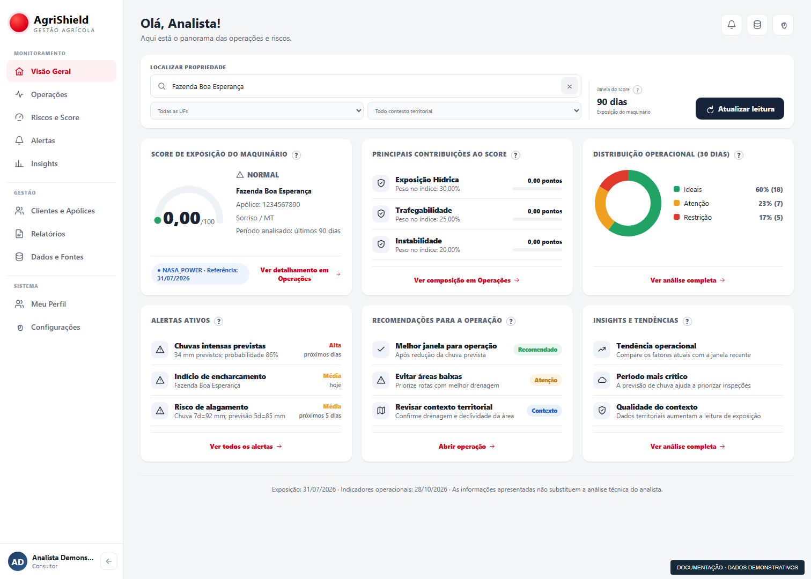

</div>

> As capturas deste README usam os componentes atuais com dados demonstrativos em ambiente local. O briefing nas imagens é um exemplo editorial para documentação. Consulte a [procedência das imagens](docs/screenshots/README.md).

## Conteúdo

- [Sobre e evolução do projeto](#sobre)
- [Funcionalidades atuais](#funcionalidades)
- [Galeria da interface](#telas)
- [Arquitetura e fontes](#arquitetura)
- [Modelos de risco e exposição](#modelos)
- [Como a LLM gera os insights](#insights)
- [Autenticação e persistência](#autenticacao)
- [Estrutura e tecnologias](#estrutura)
- [Instalação e configuração](#instalacao)
- [Vercel e Supabase](#publicacao)
- [API, processamento e testes](#api)
- [Limitações e solução de problemas](#limitacoes)
- [Documentação aprofundada](#documentacao)

<a id="sobre"></a>

## Sobre o projeto

O **AgriShield** é uma plataforma acadêmica desenvolvida para o **Challenge Sompo Seguros**, voltada a analistas e consultores que acompanham propriedades e operações agrícolas. Reúne cadastro, meteorologia, contexto territorial, inventário de máquinas e indicadores explicáveis em uma mesma interface.

O sistema ajuda a responder: quais fatores pesam na leitura operacional de uma fazenda? Quais perigos ambientais compõem sua exposição? Quais informações precisam ser confirmadas com o responsável local? Como estão os seguros registrados para os equipamentos?

O fluxo parte do cadastro da propriedade, enriquece sua localização com fontes externas, calcula indicadores por regras explícitas e apresenta evidências, alertas e prioridades. Na página **Insights**, uma LLM transforma um contexto estruturado do backend em um briefing para a conversa com o segurado.

### Evolução em relação à primeira versão

| Área | Implementação atual |
|---|---|
| Acesso | Login sem senha pelo Supabase Auth, confirmação de e-mail, aprovação de contas e gestão administrativa |
| Persistência | Supabase como opção de produção; CSV, JSON e memória em fluxos locais específicos |
| Propriedades | Endereço completo, várias apólices, área, coordenadas no mapa, perímetro, edição e arquivamento/restauração |
| Maquinários | Inventário por fazenda, cadastro individual, importação CSV validada, horímetros e situação dos seguros |
| Exposição | Cinco perigos, composição explicável, comparação de janelas de 90 dias e qualidade dos dados |
| Parâmetros | 22 parâmetros configuráveis entre pesos dos perigos e componentes internos |
| Insights | Radar determinístico, previsão de sete dias, resumo da frota, contexto cadastral e briefing com GPT-4o mini |
| Território | SRTM/MERIT Hydro, mapa de análise e integração MapBiomas |
| Operação | Processamento climático acompanhado por status, PDF por apólice e interface responsiva |

O projeto continua sendo um **protótipo acadêmico**. Os índices não representam probabilidade atuarial de sinistro; os modelos de exposição ainda não foram calibrados contra uma base de sinistros.

<a id="funcionalidades"></a>

## Funcionalidades atuais

| Módulo | O que o usuário encontra |
|---|---|
| **Visão Geral** | Score operacional, condição atual, distribuição dos últimos 30 dias, alertas, fatores e atalhos |
| **Clientes e Apólices** | Busca, filtros, ordenação, edição, arquivamento/restauração, processamento climático, acesso à frota e PDFs |
| **Cadastro de Fazenda** | ViaCEP, geocodificação, confirmação de coordenadas, mapa Leaflet e perímetro |
| **Maquinário agrícola** | Equipamentos por fazenda, tipo, fabricante, modelo, ano, identificação, uso e seguros cadastrados |
| **Operações** | Cadastro consolidado, indicadores geoespaciais, mapa e análise de exposição do maquinário |
| **Riscos e Score** | Consulta e ajuste de pesos/fatores do modelo de exposição, com explicações e validação |
| **Alertas** | Ocorrências derivadas dos indicadores e da previsão, com severidade e contexto |
| **Insights** | Prioridades calculadas, briefing assistido por IA, previsão, frota e indicadores do portfólio |
| **Relatórios** | Consolidação visual e impressão pelo navegador; PDF por apólice disponível na listagem de clientes |
| **Dados e Fontes** | Cadastro, registro territorial, versões e parâmetros; o painel de exposição em Operações detalha o papel das fontes |
| **Meu Perfil / Configurações** | Perfil, sessão, informações do ambiente e atalhos |
| **Gerenciar Acessos** | Aprovação e rejeição de contas pelo administrador definido na implementação |

As telas compartilham a propriedade selecionada. A navegação é controlada pelo estado React em `App.jsx`; não há React Router nem uma URL independente para cada módulo.

<a id="telas"></a>

## Galeria da interface

Todas as imagens são capturas da interface atual, com dados demonstrativos identificados na própria imagem. Clique para abrir em tamanho completo.

### Clientes, apólices e inventário

[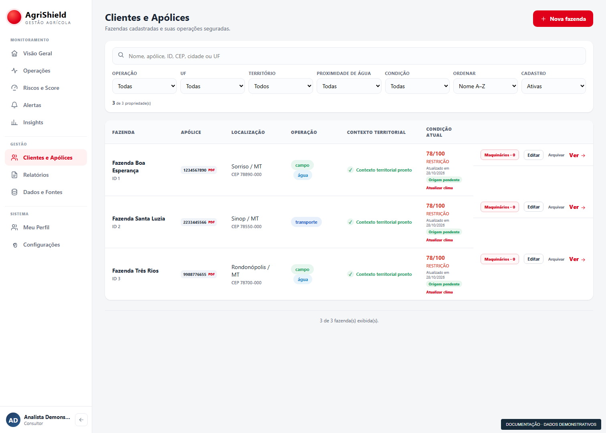](docs/screenshots/02-clientes-apolices.png)

A listagem reúne propriedades e apólices e oferece acesso ao inventário, ao processamento do clima e aos relatórios.

[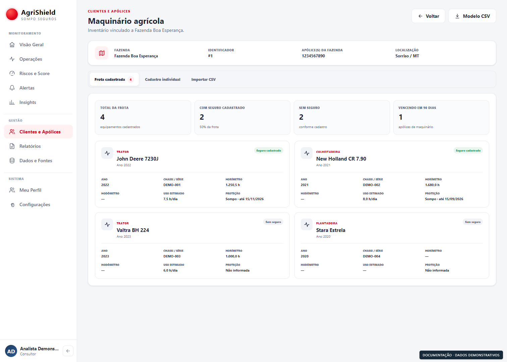](docs/screenshots/03-maquinarios.png)

O inventário registra equipamentos e fornece os agregados de frota usados em Insights.

<details>
<summary><strong>Ver cadastro e parâmetros de risco</strong></summary>

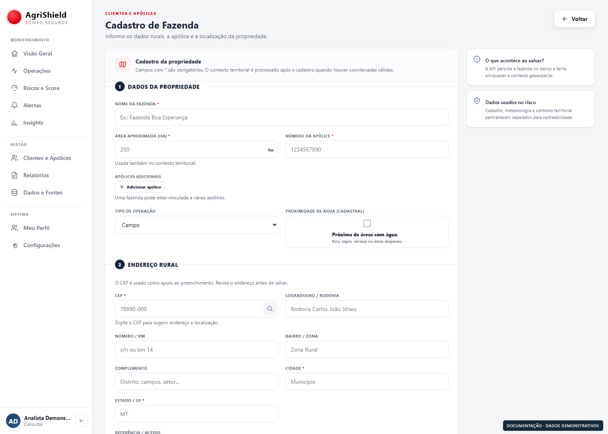

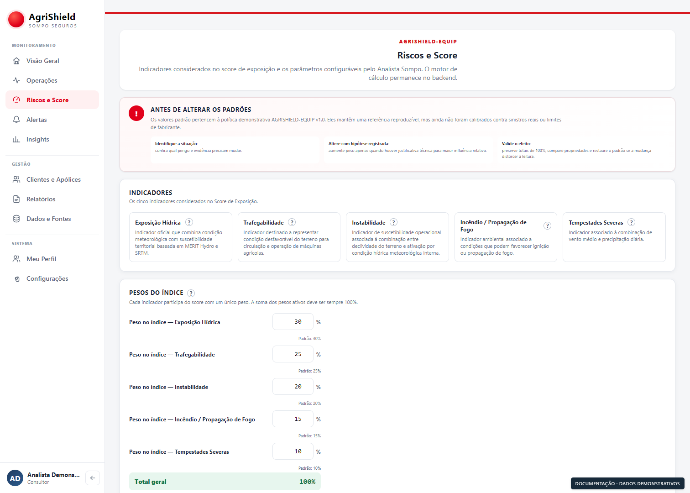

</details>

### Insights: indicadores e briefing assistido

[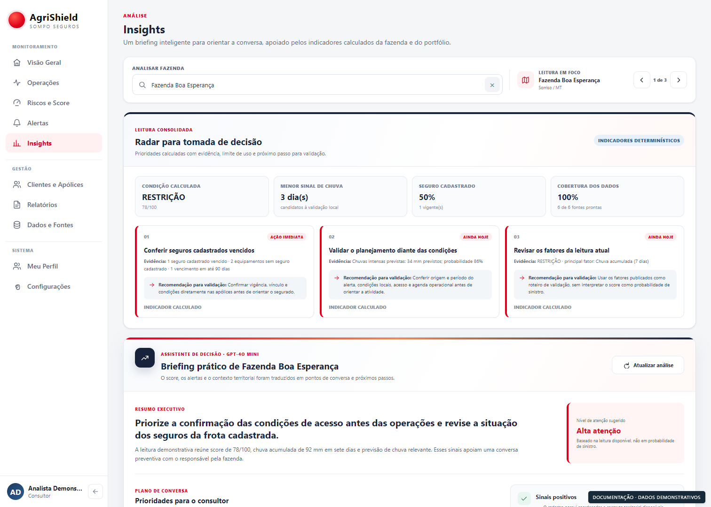](docs/screenshots/06-insights.png)

O radar é calculado pelas regras da aplicação. O briefing abaixo dele recebe a resposta estruturada da LLM.

[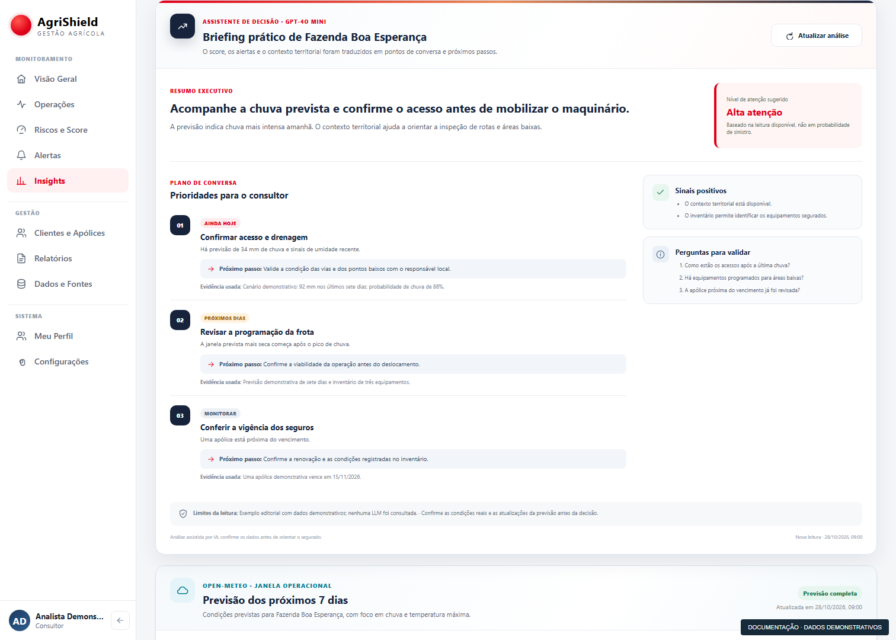](docs/screenshots/07-insights-briefing.png)

### Território e exposição do maquinário

[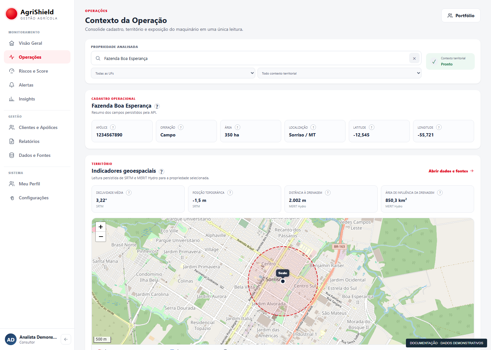](docs/screenshots/09-operacoes-territorio.png)

[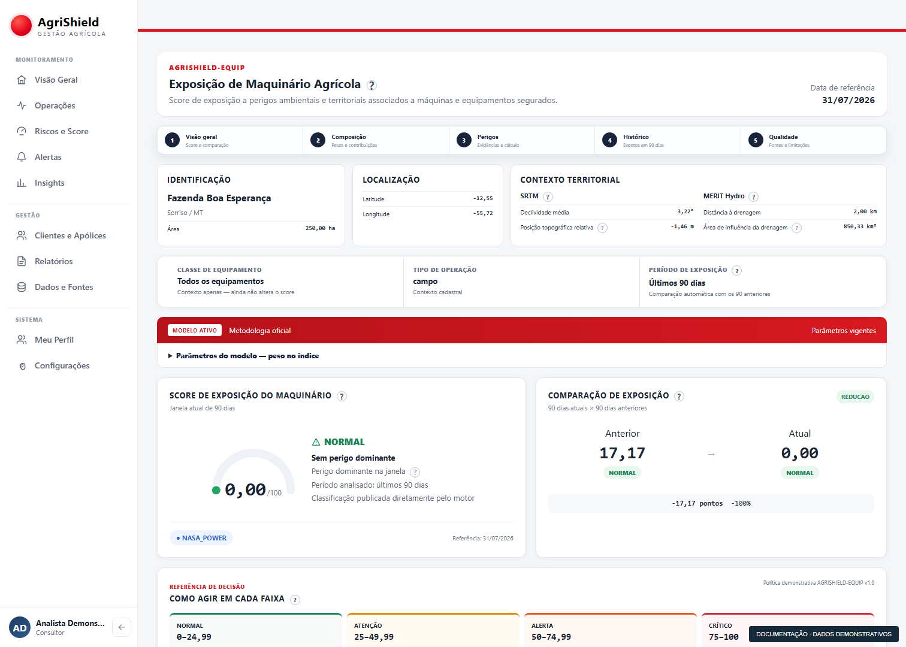](docs/screenshots/10-exposicao-maquinario.png)

<details>
<summary><strong>Ver login e versão móvel de Insights</strong></summary>

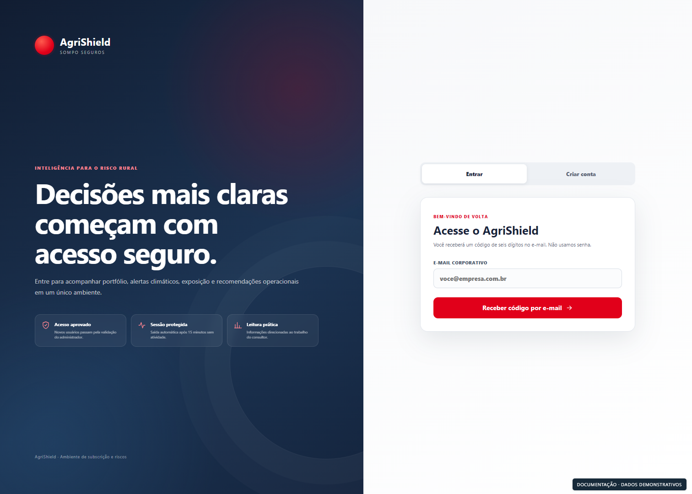

<p align="center">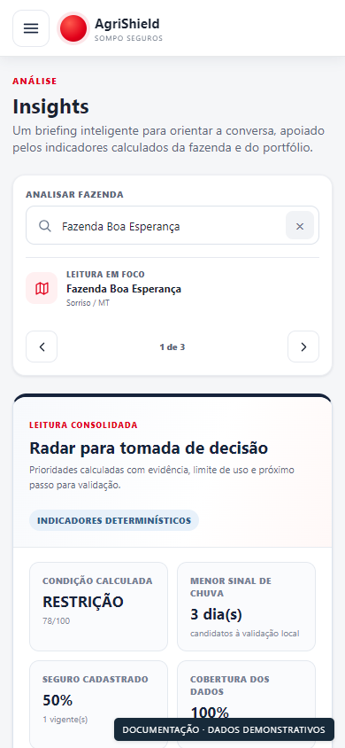</p>

</details>

<a id="arquitetura"></a>

## Arquitetura e fontes

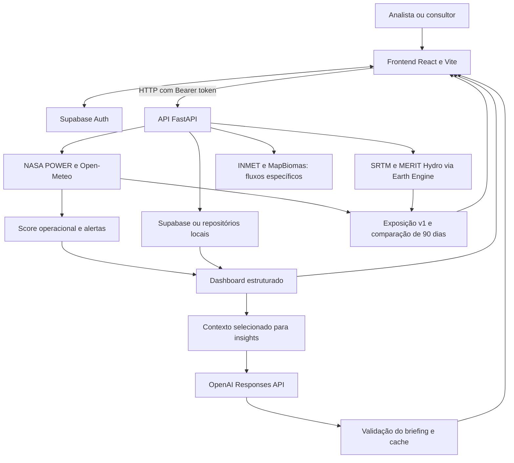

Coexistem o **score operacional do dashboard**, derivado da engenharia de variáveis, e o **modelo de exposição v1**, acessado em Operações. O briefing da LLM usa o primeiro caminho, acrescido de dados cadastrais, previsão, território e frota. A resposta de exposição v1 ainda não é inserida automaticamente no prompt.

| Fonte | Uso implementado | Distinção importante |
|---|---|---|
| **NASA POWER** | Histórico diário para o ETL operacional e para a exposição | Representação regional; o ETL legado admite histórico simulado identificado |
| **Open-Meteo** | Previsão de sete dias, recorte de cinco dias para alertas e histórico alternativo da exposição | Previsão/modelagem não equivale a observação de estação. A fachada operacional suprime a previsão sintética interna em caso de falha |
| **INMET** | Estações, seleção por distância e importação de observações históricas oficiais | Coleta explícita; não entra no score nem no contexto da LLM atualmente |
| **SRTM** | Declividade e posição topográfica relativa | Dados Earth Engine persistidos para reutilização |
| **MERIT Hydro** | Distância à drenagem e área de drenagem montante | Componente da suscetibilidade territorial hídrica |
| **MapBiomas Brasil 10.1** | Uso/cobertura da terra, distribuição por classes e metadados | Análise explícita sobre círculo equivalente; não compõe score nem briefing atuais |
| **ViaCEP** | Endereço a partir do CEP | Não fornece latitude e longitude |
| **Nominatim / compatível** | Geocodificação do endereço completo | Sugestões aproximadas exigem confirmação; provedor configurável |
| **OpenStreetMap / Leaflet** | Mapa, sede, perímetro e área de análise | Visualização do contexto; não calcula sozinho os índices |
| **OpenAI** | Briefing em português com JSON validado | Interpreta o contexto enviado; não consulta as fontes por conta própria |

Observação, previsão, histórico modelado e atributo territorial têm significados diferentes. Uma integração disponível no projeto não é necessariamente uma entrada do score.

<a id="modelos"></a>

## Modelos de risco e exposição

### Score operacional do dashboard

O fluxo legado usa NASA POWER e as regras de [`etapa3_engenharia_variaveis.py`](backend/etl/etapa3_engenharia_variaveis.py) para calcular dias sem chuva, acumulados recentes, umidade, indício de encharcamento, condição operacional e fatores explicáveis. O resultado vai de **0 a 100**:

| Score | Condição atual |
|---|---|
| Abaixo de 35 | Ideais |
| De 35 a 59 | Atenção |
| A partir de 60 | Restrição |

A distribuição de condições dos últimos 30 dias é outro indicador, construído com classificações diárias. Recomendações genéricas e atalhos do dashboard são textos da interface; o briefing da LLM fica na página Insights.

### Exposição de maquinário v1

A política `AGRISHIELD-EQUIP-v1.0` calcula cinco perigos:

| Perigo | Base da leitura |
|---|---|
| **Exposição Hídrica** | Condição meteorológica combinada com drenagem, área montante e topografia |
| **Trafegabilidade** | Chuva diária, acumulado de três dias e recuperação após chuva |
| **Instabilidade** | Suscetibilidade por declividade ativada pela condição hídrica temporal |
| **Incêndio / Propagação de Fogo** | Proxy de temperatura, baixa umidade, vento e secura antecedente |
| **Tempestades** | Proxy de vento médio diário e chuva; não é medição de rajadas ou detecção de granizo |

O backend compõe índices diários, agrega 90 dias, avalia qualidade/cobertura e compara com os 90 dias anteriores. Verifica disponibilidade e publicabilidade antes da apresentação. As faixas são **Normal, Atenção, Alerta e Crítico**, diferentes da condição operacional do dashboard.

Os pesos padrão no código são **30% / 25% / 20% / 15% / 10%**. O [CSV versionado](backend/data/parametros_score.csv) contém valores atuais **40% / 15% / 20% / 15% / 10%**. Em execução, vale o repositório ativo, inclusive a configuração persistida no Supabase. A tela Riscos e Score consulta os valores vigentes pela API.

O inventário fornece contexto e agregados, mas o score de exposição é calculado para a fazenda. Não estima risco individual por marca, modelo, chassi ou horas reais de cada máquina.

### Hídrico v2 experimental

Há um módulo separado para simulações, comparações e validação do componente hídrico v2. Seus endpoints e scripts **não substituem automaticamente** a exposição v1 da aplicação. A [documentação do backend](sobre_o_projeto/BACKEND.md) explica a fórmula efetiva, os parâmetros e as diferenças.

<a id="insights"></a>

## Como a LLM gera os insights

**O backend calcula indicadores; a LLM interpreta um contexto estruturado e redige o briefing.** O modelo não recebe acesso livre ao banco, não navega pelas fontes e não produz o score numérico do sistema.

### Da propriedade selecionada ao briefing

1. O frontend carrega o dashboard da fazenda selecionada.
2. Ao abrir Insights, envia `POST /api/fazendas/{id}/insights-ia` com `{ "forcar": false }`. O corpo não leva o prompt nem os indicadores: o backend monta o contexto.
3. A API reúne score operacional, fatores, métricas, distribuição de 30 dias, alertas, previsão de cinco/sete dias, campos territoriais, resumo da frota e agregados do portfólio.
4. O serviço normaliza o contexto e calcula uma assinatura com dados, modelo e versão do prompt. Procura uma resposta compatível em memória e depois no Supabase, se configurado.
5. Quando precisa gerar, envia instruções e contexto JSON à **OpenAI Responses API**, com **`gpt-4o-mini`** no fluxo padrão e saída definida por JSON Schema.
6. O retorno de uma nova geração passa pela validação Pydantic antes de chegar à interface, que exibe prioridades, evidências, ações, perguntas e limitações. Leituras recuperadas do cache não são revalidadas por esse caminho.

### Quais dados entram e para quê

| Bloco | Informações enviadas | Papel na interpretação |
|---|---|---|
| Propriedade | Identificador, nome, município/UF, área e operação | Situar a leitura no contexto cadastral |
| Dashboard | Score, condição, fatores, métricas e distribuição recente | Explicar sinais calculados pelo sistema |
| Alertas e previsão | Ocorrências e dados de cinco/sete dias | Sugerir pontos de atenção para validação |
| Território | Campos selecionados, status e qualidade | Descrever contexto e lacunas disponíveis |
| Frota | Quantidades, seguros, vencimentos, idade e horas agregadas | Priorizar conferências de cadastro e seguros |
| Portfólio | Contagens e distribuição cadastral agregada | Contextualizar o conjunto de propriedades |

Não são enviados números de apólice nem a lista individual de equipamentos/chassis. Essa seleção **não equivale a anonimização**: nome e município são enviados; a qualidade territorial pode incluir coordenadas de um pixel de drenagem. O documento de IA detalha os campos.

### O que a LLM devolve

O contrato contém `resumo_executivo`, `nivel_atencao`, `leitura_principal`, `prioridades`, `perguntas_consultor`, `pontos_positivos` e `limitacoes`. Cada prioridade traz motivo, ação recomendada e `dado_base`, para conferir a evidência citada.

Por exemplo, com chuva acumulada elevada, previsão relevante e seguros vencidos no cadastro, o briefing pode sugerir confirmar a transitabilidade e revisar as apólices. É uma orientação para validação sustentada pelo contexto, sem garantia de ocorrência de sinistro.

### O que funciona sem LLM

Radar de decisão, classificação visual da previsão diária, cobertura das informações, totais de frota, percentuais e distribuições vêm de regras de frontend/backend. A cobertura em Insights usa seis verificações equiponderadas e **não é uma confiança estatística da IA**.

O briefing atual não consome `/api/v1/exposicao/{id}`, INMET, MapBiomas nem o hídrico v2. Não há treinamento, fine-tuning ou fluxo de RAG/busca vetorial implementado para esses textos.

### Cache, atualização e falhas

O cache usa **SHA-256 do contexto, modelo e versão do prompt**, sem TTL. Evita nova geração quando a assinatura coincide, mas não deduplica chamadas simultâneas. **Atualizar análise** envia `{ "forcar": true }`: refaz o texto sem obrigar uma nova coleta histórica NASA.

Quando é necessária uma nova geração e a chave está ausente, o provedor falha ou a saída é inválida, a interface informa a indisponibilidade do briefing. Um cache compatível ainda pode ser servido sem nova chamada. Os indicadores determinísticos continuam disponíveis; o sistema não substitui a resposta por um texto inventado apresentado como IA.

Leia a explicação completa de contexto, prompt, contrato, cache, erros, privacidade e exemplo comentado em [**Insights e LLM**](sobre_o_projeto/INSIGHTS_E_LLM.md).

<a id="autenticacao"></a>

## Autenticação e persistência

### Acesso e sessão

Contas existentes entram pelo código recebido por e-mail no Supabase Auth. Novos cadastros confirmam o e-mail e começam pendentes de aprovação. O perfil fica em `public.agrishield_login`; a conta administrativa é definida na implementação.

O cliente envia `Authorization: Bearer <token>` nas requisições e downloads autenticados. Em produção, mantenha `AGRISHIELD_AUTH_REQUIRED=true`. `/api/auth/*` sempre valida sessão; as outras rotas `/api/*` exigem perfil aprovado quando a proteção está ativa. O frontend monitora os 15 minutos de inatividade.

- **Frontend:** URL e chave pública/publishable do Supabase.
- **Backend:** chave secreta Supabase, chave OpenAI e configuração das fontes.
- Chaves secretas não devem receber prefixo `VITE_`: essas variáveis são incorporadas ao navegador.

O modelo atual não implementa carteira privada de fazendas por usuário. Aprovação de acesso não equivale a isolamento multiempresa. Gestão de usuários tem verificação administrativa específica; edição de parâmetros segue a proteção geral da API.

### Persistência por ambiente

| Dado | Com Supabase configurado | Alternativa local |
|---|---|---|
| Fazendas, apólices e geoespacial | Tabelas da aplicação | CSV e cache geoespacial |
| Máquinas e importações | Tabelas relacionadas à fazenda | Memória, sem durabilidade |
| Séries/indicadores climáticos | Persistência climática Supabase | CSVs brutos, enriquecidos e indicadores |
| Parâmetros de exposição | Repositório Supabase | `parametros_score.csv` |
| INMET e MapBiomas | Repositórios Supabase já implementados | Memória, sem durabilidade |
| Insights de IA | Cache Supabase e memória | Somente memória |
| Usuários e aprovação | Supabase Auth + `agrishield_login` | Sem substituto CSV para o login completo |

A escolha é feita pela configuração. Uma falha em um Supabase já configurado não significa troca automática por CSV. Veja os [detalhes de persistência](sobre_o_projeto/BACKEND.md).

<a id="estrutura"></a>

## Estrutura e tecnologias

```text
agrieshield-sompo/
├── api/index.py                  # Entrada ASGI na Vercel
├── backend/
│   ├── app/                      # API, autenticação, IA, PDFs e serviços
│   ├── etl/                      # Cadastro, NASA, variáveis e geoespacial
│   ├── exposicao/                # Perigos, política e comparação histórica
│   ├── risco/                    # Contratos e funções de risco
│   ├── inmet/                    # Estações e observações históricas
│   ├── mapbiomas/                # Uso e cobertura da terra
│   ├── persistencia/             # Supabase REST e repositórios locais
│   ├── validacao/                # Validação multirregional
│   ├── scripts/                  # Diagnósticos e experimentos
│   ├── tests/                    # Testes Python
│   └── data/                     # Bases e saídas locais
├── frontend/src/
│   ├── auth/                     # Login, sessão e aprovação
│   ├── api/                      # HTTP autenticado e contratos
│   ├── pages/                    # Páginas
│   ├── components/               # Mapas, exposição, parâmetros e ajuda
│   ├── cadastro/                 # Regras dos formulários
│   ├── content/                  # Conceitos e explicações
│   ├── layout/                   # Menu, cabeçalhos e ícones
│   └── App.jsx                   # Navegação e estado compartilhado
├── supabase/
│   ├── schema.sql                # Schema idempotente e acesso
│   ├── migrations/               # Migrações versionadas
│   └── templates/                # E-mails
├── docs/screenshots/             # Novas capturas e procedência
├── sobre_o_projeto/              # Documentação técnica e .txt completo
├── .env.example
├── requirements.txt              # Dependências do deploy da raiz
├── vercel.json
└── 00_...bat a 08_...bat          # Auxiliares Windows
```

| Camada | Tecnologias declaradas |
|---|---|
| Interface | React / React DOM 18.3.1, Vite 5.4.10, Leaflet `^1.9.4`, Supabase JS 2.117.1 |
| API | FastAPI 0.115.0, Uvicorn 0.30.6, Pydantic 2.9.2 |
| Dados | Pandas 2.2.3, NumPy 2.1.3, Requests 2.32.3, HTTPX 0.28.1 |
| Geoespacial | Earth Engine API 1.7.38 |
| Relatórios | ReportLab 4.4.3 |
| Configuração | python-dotenv 1.2.2 |
| Testes | unittest, Vitest e Testing Library |

Consulte os manifests e lockfile para instalar as versões do projeto. OpenAI é chamada por HTTP no backend; não há dependência do SDK Python `openai`.

<a id="instalacao"></a>

## Instalação e configuração

### Pré-requisitos

- Python **3.12 ou 3.13** de 64 bits; `.python-version` indica 3.13.
- Node.js/npm compatíveis com o Vite 5 versionado.
- Internet para instalação, autenticação, mapas e fontes.
- Supabase configurado para usar a interface autenticada completa.
- Chave OpenAI para o briefing; indicadores calculados não dependem dela.
- Conta/projeto Earth Engine autorizado para novos processamentos territoriais.

### 1. Instalar dependências

```powershell
git clone https://github.com/ThatsTom/agrieshield-sompo.git
cd agrieshield-sompo
py -3.13 -m venv backend/.venv
backend/.venv/Scripts/python.exe -m pip install -r backend/requirements.txt
cd frontend
npm.cmd ci
cd ..
```

Para Python 3.12, troque por `py -3.12`. Os `.bat` oferecem um fluxo guiado no Windows.

### 2. Backend e Supabase

Em uma instalação nova, copie [`.env.example`](.env.example) para `.env` na raiz e preencha os valores. Preserve a configuração existente se já tiver o ambiente preparado.

```dotenv
SUPABASE_URL=https://SEU_PROJECT_REF.supabase.co
SUPABASE_SECRET_KEY=sb_secret_SUA_CHAVE_BACKEND
OPENAI_API_KEY=SUA_CHAVE_OPENAI
AGRISHIELD_AUTH_REQUIRED=true
ALLOWED_ORIGINS=http://127.0.0.1:5173,http://localhost:5173
EARTH_ENGINE_PROJECT=seu-projeto-gcp-autorizado
```

O exemplo inclui ainda `AGRISHIELD_GEOCODING_URL` e `AGRISHIELD_GEOCODING_USER_AGENT`. O backend carrega o `.env` da raiz; variáveis do processo têm prioridade. NASA POWER não exige chave na integração implementada.

Execute [`supabase/schema.sql`](supabase/schema.sql) no SQL Editor do projeto destinado à aplicação. Configure as URLs de autenticação e redirecionamento para o ambiente local/deploy. Os [templates](supabase/templates/) usam `{{ .Token }}` no login de contas existentes e `{{ .ConfirmationURL }}` na confirmação inicial.

A conta administradora é definida em [`backend/persistencia/login.py`](backend/persistencia/login.py) e no schema. Ao adaptar para outra conta, mantenha os dois consistentes. Usuários comuns precisam de aprovação após o cadastro.

### 3. Frontend

Crie `frontend/.env.local`:

```dotenv
VITE_API_URL=http://127.0.0.1:8000
VITE_SUPABASE_URL=https://SEU_PROJECT_REF.supabase.co
VITE_SUPABASE_PUBLISHABLE_KEY=SUA_CHAVE_PUBLICA
```

[`frontend/.env.production.example`](frontend/.env.production.example) é o modelo com autenticação. O `.env.example` simplificado do frontend contém só a URL da API e não configura o login sozinho. Reinicie o Vite após alterar variáveis.

### 4. Iniciar

No terminal do backend, a partir da raiz:

```powershell
backend/.venv/Scripts/python.exe -m uvicorn backend.app.main:app --host 127.0.0.1 --port 8000 --reload
```

Em outro terminal:

```powershell
cd frontend
npm.cmd run dev
```

| Serviço | Endereço local |
|---|---|
| Interface | <http://127.0.0.1:5173> |
| API / saúde | <http://127.0.0.1:8000/health> |
| Swagger | <http://127.0.0.1:8000/docs> |
| OpenAPI | <http://127.0.0.1:8000/openapi.json> |

Sem configuração/sessão Supabase, o frontend não libera uma demonstração pública. O fallback `demoData.js` ocorre dentro da área autenticada após falha na listagem. O backend pode ser usado isoladamente com repositórios locais; isso não substitui o login da interface.

### Earth Engine

Para novas áreas, autentique a conta e verifique o projeto autorizado:

```powershell
backend/.venv/Scripts/python.exe -c "import ee; ee.Authenticate()"
backend/.venv/Scripts/python.exe -c "import os,ee; from dotenv import load_dotenv; load_dotenv(); ee.Initialize(project=os.environ['EARTH_ENGINE_PROJECT']); print('Earth Engine OK')"
```

Contexto territorial já persistido pode ser reutilizado. A aplicação não chama `ee.Authenticate()` automaticamente.

### Auxiliares Windows

| Arquivo | Finalidade |
|---|---|
| `00_instalar_pre_requisitos.bat` | Verificar/instalar Python e Node |
| `01_instalar_dependencias.bat` | Preparar dependências |
| `02_iniciar_projeto.bat` | Abrir os serviços e a interface |
| `03_executar_etl_completo.bat` | Etapas climáticas 1 a 3; geoespacial é separado |
| `04_verificar_instalacao.bat` | Conferir instalação e contexto local |
| `05_reinstalar_backend.bat` / `06_reinstalar_frontend.bat` | Recuperar dependências |
| `07_abrir_github.bat` | Abrir o repositório |
| `08_testar_nasa_power.bat` | Diagnosticar acesso à NASA POWER |

O [guia de instalação Windows](INSTALACAO_DO_ZERO.md) complementa a preparação do computador; autenticação e IA estão atualizadas nos passos acima.

<a id="publicacao"></a>

## Vercel e Supabase

O backend tem entrada ASGI em [`api/index.py`](api/index.py) e configuração na raiz em [`vercel.json`](vercel.json). O frontend é um projeto Vite separado, com raiz `frontend/` e saída `dist/`.

Endereços de referência registrados no projeto, sujeitos ao estado de cada deploy:

- [Frontend AgriShield](https://agrishield-sompo-frontend.vercel.app)
- [Backend AgriShield](https://agrishield-sompo-backend.vercel.app)
- [Swagger do backend](https://agrishield-sompo-backend.vercel.app/docs)

No backend, configure `SUPABASE_URL`, `SUPABASE_SECRET_KEY`, `OPENAI_API_KEY`, `AGRISHIELD_AUTH_REQUIRED=true` e `ALLOWED_ORIGINS`. No frontend, defina as três variáveis `VITE_*` da instalação para o ambiente correto. Complete as URLs e templates de autenticação.

Credenciais Earth Engine devem estar disponíveis ao processo para novas análises. Autenticar apenas o computador do desenvolvedor não provisiona o ambiente serverless.

O processamento climático usa tarefas em segundo plano localmente e roda dentro da requisição na Vercel. Arquivos locais e memória não são persistência durável entre instâncias. Veja os [detalhes operacionais](sobre_o_projeto/BACKEND.md).

<a id="api"></a>

## API, processamento e testes

### Principais endpoints

| Método | Caminho | Finalidade |
|---|---|---|
| GET | `/health` | Saúde do serviço |
| GET / PUT | `/api/auth/me` · `/api/auth/perfil` | Ler acesso / atualizar perfil |
| GET / PATCH | `/api/auth/usuarios` · `/api/auth/usuarios/{id}/acesso` | Gestão administrativa |
| GET | `/api/cep/{cep}` | Endereço |
| POST | `/api/geocodificacao/endereco` | Geocodificação |
| GET / POST | `/api/fazendas` | Listar / cadastrar |
| PUT | `/api/fazendas/{id}` | Editar |
| POST | `/api/fazendas/{id}/arquivamento` | Arquivar/restaurar |
| GET | `/api/fazendas/{id}/dashboard` | Score, alertas, previsão e frota |
| GET | `/api/fazendas/{id}/score` · `/api/fazendas/{id}/alertas` | Indicadores individuais |
| POST / GET | `/api/fazendas/{id}/clima/processar` · `/api/fazendas/{id}/clima/status` | Processamento e acompanhamento |
| GET / POST | `/api/fazendas/{id}/maquinarios` | Consultar / cadastrar frota |
| POST | `/api/fazendas/{id}/maquinarios/importacoes/validar` | Validar CSV |
| POST | `/api/fazendas/{id}/maquinarios/importacoes` | Confirmar importação |
| GET | `/api/maquinarios/modelo.csv` | Modelo CSV |
| GET / POST | `/api/fazendas/{id}/geoespacial` · `/api/fazendas/{id}/geoespacial/recalcular` | Consultar / recalcular território |
| GET | `/api/v1/exposicao/{id}` | Exposição e comparação histórica |
| GET / PUT | `/api/v1/parametros-score` | Consultar / atualizar parâmetros |
| POST | `/api/fazendas/{id}/insights-ia` | Gerar/reutilizar briefing |
| GET | `/api/fazendas/{id}/relatorio.pdf` | PDF com seleção de apólice |
| POST | `/api/cache/limpar` | Limpar caches em memória |

INMET, MapBiomas e hídrico experimental têm rotas próprias detalhadas no [backend](sobre_o_projeto/BACKEND.md). O OpenAPI da versão executada contém os schemas e parâmetros completos. Em rotas protegidas, use o token de uma conta aprovada.

### Pipeline

1. **Cadastro:** propriedade, endereço, operação e localização.
2. **Histórico:** NASA POWER com rastreabilidade da origem e eventual simulação do fluxo legado.
3. **Variáveis:** acumulados, secura, umidade, condição, score e fatores.
4. **Território:** SRTM/MERIT Hydro persistidos para reutilização.
5. **Exposição:** histórico, território e parâmetros para perigos e comparação de janelas.
6. **Apresentação:** contratos para a interface e contexto selecionado para a LLM.

INMET e MapBiomas têm processamentos explícitos; não rodam automaticamente em toda consulta ao dashboard.

### Verificação local

```powershell
# Na raiz
backend/.venv/Scripts/python.exe -B -m unittest discover -s backend/tests -p "test_*.py"

# No frontend
cd frontend
npm.cmd test
npm.cmd run build
```

As suítes cobrem contratos, autenticação, persistência, cálculos, fontes, IA, formulários e componentes. Muitos testes usam mocks; aprovação local não comprova, sozinha, a disponibilidade de serviços externos ou de um deploy.

<a id="limitacoes"></a>

## Limitações e solução de problemas

### Limites atuais

- Índices acadêmicos ainda não calibrados contra sinistros ou telemetria de operação real.
- Inventário sem rastreamento ao vivo; horas e médias são cadastradas. A interface não oferece edição/exclusão individual de máquinas.
- Polígono exibido no mapa não significa uso do mesmo contorno em todos os cálculos. MapBiomas usa círculo equivalente; geoespacial trabalha com áreas de análise próprias.
- INMET e MapBiomas podem persistir no Supabase, mas não alimentam score/briefing atuais.
- O ETL legado admite histórico simulado identificado. Em falha Open-Meteo, a fachada retorna previsão vazia com origem `fallback_simulado`, suprimindo os valores sintéticos internos.
- Validação estrutural da saída não garante correção factual do briefing; o analista precisa conferir evidências e condições locais.
- Cache de IA sem TTL/deduplicação concorrente. Limpar memória não apaga todos os registros persistidos.
- Aprovação de conta não implementa isolamento de carteira por usuário.

### Problemas comuns

| Sintoma | O que conferir |
|---|---|
| “Autenticação não configurada” | Variáveis públicas Supabase e reinício do Vite |
| Acesso pendente após confirmar e-mail | Aprovação administrativa |
| Código não chega | Templates, entrega/limites de e-mail e intervalo indicado na tela |
| 401 / 403 | Sessão, confirmação, token e perfil aprovado |
| Falha de conexão / CORS | Serviços, `VITE_API_URL` e `ALLOWED_ORIGINS` |
| Modo de demonstração | A listagem falhou após o acesso; conferir API. Não confirma carga dos dados persistidos |
| Indicadores reais indisponíveis | Processamento e origem; o app não associa automaticamente dashboard demo a uma fazenda real |
| Briefing indisponível | `OPENAI_API_KEY` no backend, acesso ao modelo, rede e resposta da API |
| Território ausente | Coordenadas, autorização Earth Engine e recálculo |
| MapBiomas sem resultado | Processamento explícito, área, ano e autorização |
| Dados somem após reiniciar | Repositório em memória; revisar persistência do ambiente |
| Exposição difere do dashboard | Modelos, variáveis, janelas e classificações diferentes |

<a id="documentacao"></a>

## Documentação aprofundada

A pasta [`sobre_o_projeto/`](sobre_o_projeto/README.md), na raiz, contém a explicação por camada e a versão consolidada em texto simples:

| Documento | Conteúdo |
|---|---|
| [Guia de leitura](sobre_o_projeto/README.md) | Visão do sistema e organização dos documentos |
| [Backend](sobre_o_projeto/BACKEND.md) | API, regras, fontes, ETL, persistência, acesso e exposição |
| [Frontend](sobre_o_projeto/FRONTEND.md) | React, telas, fluxos, mapas, estado e integração |
| [Insights e LLM](sobre_o_projeto/INSIGHTS_E_LLM.md) | Dados enviados, pré-cálculos, prompt, schema, cache, falhas e exemplos |
| [Texto completo](sobre_o_projeto/SOBRE_O_PROJETO.txt) | Documento consolidado para editor de texto |
| [Procedência das capturas](docs/screenshots/README.md) | Produção das imagens e dados demonstrativos |
| [Instalação Windows](INSTALACAO_DO_ZERO.md) | Preparação do computador |
| [NASA POWER](docs/NASA_POWER.md) | Orientações da integração |
| [Gestão de portfólio](docs/PORTFOLIO_AVANCADO.md) | Contexto complementar da listagem |

Documentação baseada nesta revisão do código. O comportamento de um ambiente também depende das variáveis, dos dados persistidos e da versão implantada.

[Voltar ao início](#topo)
