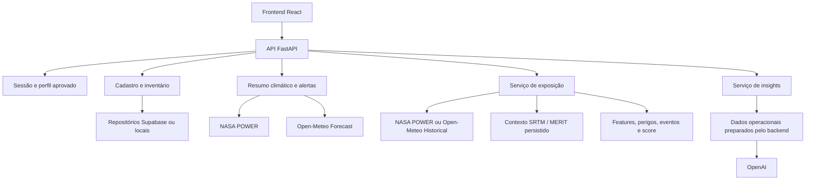

# Backend do AgriShield

Este documento descreve o backend presente no repositório em 26/10/2026: uma API Python/FastAPI que combina cadastro de propriedades e apólices, inventário de maquinários, dados meteorológicos, contexto territorial, regras demonstrativas de exposição, relatórios e insights por IA. A descrição considera o código implementado; integrações disponíveis e capacidades futuras são diferenciadas ao longo do texto.

Para a visão de uso e instalação, consulte o [README principal](../README.md). A interface está descrita em [FRONTEND.md](FRONTEND.md), e o fluxo de dados enviado à LLM, os prompts, a resposta estruturada e as regras de cache estão explicados em [INSIGHTS_E_LLM.md](INSIGHTS_E_LLM.md).

## 1. O que o backend entrega

O backend recebe requisições da interface, valida seus dados, consulta as fontes necessárias e devolve contratos JSON. Também produz downloads CSV e PDF. Suas responsabilidades atuais são:

- manter fazendas, endereços, localização, área, polígono cadastral, múltiplas apólices e estado de arquivamento;
- cadastrar e importar maquinários por fazenda, com validação de chassi, uso e seguro;
- processar o resumo climático operacional com histórico NASA POWER;
- obter previsão Open-Meteo, apresentar alertas e preparar o contexto do briefing de IA;
- produzir a avaliação histórica de exposição ambiental do maquinário, com cinco indicadores e comparação entre duas janelas de 90 dias;
- coletar contexto geoespacial SRTM/MERIT Hydro e resultados específicos de INMET e MapBiomas;
- persistir dados no Supabase quando configurado e oferecer caminhos locais de desenvolvimento;
- validar a sessão Supabase Auth e a aprovação de acesso da aplicação;
- gerar um relatório PDF por propriedade e apólice;
- oferecer uma comparação hídrica experimental separada da avaliação oficial da aplicação.

O projeto é um protótipo acadêmico de apoio à análise. O score é um índice demonstrativo de exposição, sem calibração atuarial por sinistros. Uma máquina cadastrada não recebe um cálculo físico individual de tombamento, falha, dano ou indenização. A avaliação de exposição usa a localização e o contexto da fazenda; o inventário complementa os resumos operacionais e os insights.

## 2. Tecnologias e organização

As dependências fixadas em [backend/requirements.txt](../backend/requirements.txt) são FastAPI 0.115.0, Uvicorn 0.30.6, Pydantic 2.9.2, Requests 2.32.3, Pandas 2.2.3, NumPy 2.1.3, Earth Engine API 1.7.38, HTTPX 0.28.1, python-dotenv 1.2.2 e ReportLab 4.4.3. O backend acessa o Supabase por um cliente REST próprio; não depende do SDK Python do Supabase. A integração OpenAI também é implementada por HTTP.

| Diretório/arquivo | Responsabilidade |
|---|---|
| [`backend/app/main.py`](../backend/app/main.py) | Criação da API, middleware, modelos de entrada, rotas e coordenação dos fluxos operacionais. |
| [`backend/app/`](../backend/app) | Serviços de aplicação, autenticação, inventário, relatório, insights e adaptação de dependências do motor de exposição. |
| [`backend/etl/`](../backend/etl) | Cadastro, coleta NASA, engenharia de variáveis, coleta territorial e repositórios de geoespacial/parâmetros. |
| [`backend/exposicao/`](../backend/exposicao) | Contratos históricos, clientes estritos, features diárias, perigos, eventos, agregação, composição e comparação do score. |
| [`backend/risco/`](../backend/risco) | Contratos e normalização de fontes, qualidade/proveniência e features de integração/diagnóstico. |
| [`backend/inmet/`](../backend/inmet) | Catálogo de estações, importação dos arquivos históricos oficiais, normalização e repositórios. |
| [`backend/mapbiomas/`](../backend/mapbiomas) | Consulta da cobertura da terra, legenda, cálculo de áreas e repositórios. |
| [`backend/persistencia/`](../backend/persistencia) | Cliente REST do Supabase, clima, jobs, perfis, inventário e insights. |
| [`backend/validacao/`](../backend/validacao) e [`backend/scripts/`](../backend/scripts) | Testes de mesa, diagnósticos de calibração e experimentos metodológicos. |
| [`backend/tests/`](../backend/tests) | Testes automatizados de domínio, serviços, persistência, autenticação e contratos HTTP. |
| [`backend/data/`](../backend/data) | Bases CSV e resultados do modo local. |
| [`supabase/schema.sql`](../supabase/schema.sql) | Estrutura das tabelas, restrições, índices, gatilhos, permissões e dados iniciais do banco. |
| [`api/index.py`](../api/index.py) | Exportação ASGI usada pela implantação Vercel. |

O motor de exposição é separado do transporte HTTP. A API chama `ServicoAvaliacaoExposicao`, que usa interfaces para buscar fazenda, histórico e contexto territorial. A fábrica de dependências conecta essas interfaces aos repositórios e clientes reais. As fórmulas recebem objetos Pydantic validados, sem importar diretamente o banco ou as rotas.



## 3. Dois fluxos de score que precisam ser diferenciados

O repositório preserva o resumo climático operacional das primeiras versões e acrescenta o motor histórico de exposição. Eles têm entradas, regras e escalas de classificação diferentes.

| Característica | Resumo climático operacional | Exposição do Maquinário v1 |
|---|---|---|
| Rota | `/api/fazendas/{id}/score` e `/dashboard` | `/api/v1/exposicao/{id}` |
| Histórico solicitado | Data atual menos 40 dias até a data atual. | 187 dias: 7 de contexto e 180 de análise. |
| Resultado principal | Condição atual, score demonstrativo, fatores, métricas e distribuição dos últimos 30 registros. | Cinco indicadores, eventos, score de cada janela de 90 dias e comparação entre elas. |
| Fonte histórica | NASA POWER do ETL legado. | NASA POWER ou Open-Meteo Historical ERA5-Land, selecionada explicitamente. |
| Falha de aquisição | O coletor legado pode produzir série simulada, marcada por `origem_dados=simulado`. | Cliente estrito: não troca de provedor nem cria série simulada. |
| Geoespacial | Não compõe a fórmula do score legado. | Contexto SRTM/MERIT validado integra a avaliação. |
| Parâmetros configuráveis pela tela | Não alteram as regras do score legado. | Alteram os pesos e coeficientes do motor histórico. |
| Classificação | `IDEAIS`, `ATENÇÃO`, `RESTRIÇÃO`. | `NORMAL`, `ATENCAO`, `ALERTA`, `CRITICO`. |

Por isso, dois números diferentes para a mesma fazenda não significam necessariamente erro. Eles respondem a perguntas diferentes. O briefing de IA prepara seu próprio contexto a partir dos dados operacionais descritos no [documento de insights](INSIGHTS_E_LLM.md); não se deve presumir que todo módulo do repositório alimenta automaticamente a LLM.

## 4. Cadastro, localização e inventário

### 4.1 Propriedades e apólices

`FazendaIn` exige nome, número principal da apólice, CEP de oito dígitos e área positiva em hectares. Também aceita uma lista adicional de apólices, endereço completo, referência de acesso, operação (`campo`/`transporte` no armazenamento Supabase), indicação cadastral de proximidade de água, coordenadas e polígono.

A validação consolida as apólices sem duplicação e exige ao menos três caracteres em cada número. Latitude e longitude devem ser informadas juntas, dentro das faixas geográficas válidas; o par `0,0` é rejeitado. Um polígono informado precisa de pelo menos três vértices; cada vértice é recebido na ordem `[longitude, latitude]` e o armazenamento o converte para GeoJSON.

O cadastro pode ser editado e arquivado/restaurado. A listagem normalmente retorna apenas registros ativos; `incluir_arquivadas=true` inclui os arquivados. Não há rota de exclusão definitiva de fazendas no contrato atual.

O cadastro é persistido antes da tentativa de enriquecimento territorial. Se existem coordenadas utilizáveis, o backend tenta coletar e salvar o geoespacial. Uma falha dessa etapa não desfaz uma fazenda já salva. Na edição, mudanças de coordenadas provocam uma nova tentativa de enriquecimento e removem o resumo de score do cache em memória.

### 4.2 CEP e endereço completo

`GET /api/cep/{cep}` consulta ViaCEP para endereço e complementa coordenadas quando houver referência conhecida. O repositório tem uma base demonstrativa de CEPs, e o modo local preserva caminhos de contingência. CEP é referência cadastral; não identifica sozinho o centro nem os limites de uma propriedade rural.

`POST /api/geocodificacao/endereco` recebe CEP, logradouro, número/km, bairro, cidade e UF. O serviço usa Nominatim/OpenStreetMap e BrasilAPI CEP v2, conforme os dados disponíveis e as validações do resultado. O Nominatim tem cache em memória de 24 horas e espaçamento de requisições de aproximadamente um segundo. URL e identificação do cliente podem ser configuradas por ambiente.

O retorno é uma sugestão de localização. A confirmação do ponto e do perímetro depende do usuário e da qualidade do endereço fornecido.

### 4.3 Maquinários

O inventário armazena tipo de equipamento, marca/modelo, ano, chassi e apelido, além de horímetro, hodômetro, média de horas por dia e situação de seguro. Os tipos atuais são trator, colheitadeira, pulverizador autopropelido, plantadeira, implemento de arrasto, plataforma e utilitário de apoio.

As validações incluem coerência de marca/seguradora com os campos “outro”, horímetro para equipamentos motorizados, limites de valores e dados de apólice quando `possui_seguro=true`. O chassi é normalizado e sua duplicação na mesma fazenda é rejeitada. O banco também contém restrição de unicidade por fazenda/chassi.

O fluxo de importação tem três passos: baixar o modelo CSV, validar o conteúdo para receber erros por linha/campo e enviar o arquivo para importação. A API recebe o texto no campo JSON `conteudo_csv`; não é um upload multipart. A importação repete a validação e rejeita o lote quando encontra erros. Não permite novos cadastros/importações em fazenda arquivada.

O resumo da frota é incluído no dashboard e no contexto de insights. Ele representa os registros ativos e a situação declarada de seguro/uso; não constitui telemetria em tempo real. O inventário não altera diretamente as fórmulas do motor histórico de exposição.

## 5. Pipeline climático operacional

### 5.1 Aquisição NASA POWER

[`etapa2_coleta_nasa_power.py`](../backend/etl/etapa2_coleta_nasa_power.py) consulta o produto diário por ponto, comunidade `AG`, com temperatura média/máxima/mínima, precipitação corrigida, umidade relativa, radiação e vento a 2 m. O sentinela `-999` é convertido para ausência de dado.

No caminho operacional legado, exceções na consulta/parsing geram uma série demonstrativa determinística. Ela tem origem `simulado`, que acompanha o resumo persistido. Essa contingência mantém a demonstração utilizável, mas não deve ser apresentada como observação meteorológica real. Uma resposta real cujo DataFrame fique sem medições disponíveis resulta em erro `503` no processamento da API.

### 5.2 Engenharia de variáveis e condição atual

[`etapa3_engenharia_variaveis.py`](../backend/etl/etapa3_engenharia_variaveis.py) transforma o histórico em variáveis legadas. Valores numéricos ausentes são preenchidos pela mediana da coluna quando possível, e a precipitação negativa é limitada a zero. Em seguida, calcula dias consecutivos com chuva inferior a 1 mm, faixas de estiagem, classificação agroclimática diária, chuva acumulada em 3/7 dias e umidade média de 3 dias.

O indicador chamado `solo_encharcado` é uma heurística: chuva de 7 dias acima de 50 mm **e** umidade relativa atmosférica média de 3 dias acima de 70%. Ele não vem de um sensor de solo, medição de inundação ou produto de umidade volumétrica.

O score operacional soma pontos por chuva recente, umidade atmosférica/indício de encharcamento, proximidade de água declarada, condição agroclimática do dia e ajuste para transporte. O total é limitado a 100. As condições finais são:

- abaixo de 35: `IDEAIS`;
- de 35 até menos de 60: `ATENÇÃO`;
- a partir de 60: `RESTRIÇÃO`.

O resultado conserva os fatores e seus pontos, as métricas utilizadas e a distribuição de condições nos últimos 30 registros. As regras completas estão no arquivo de engenharia de variáveis; seus pontos não são os pesos configuráveis do motor de exposição v1.

### 5.3 Persistência, cache e atualização

Sem Supabase configurado, o fluxo gera `nasa_power_bruto_{id}.csv`, `nasa_power_enriquecido_{id}.csv` e `dashboard_indicadores_{id}.csv`, em `backend/data/`. Com Supabase, salva observações enriquecidas e o resumo nas tabelas correspondentes, sem depender desses CSVs como banco de produção.

O processo mantém `_cache_score` em memória e pode hidratar esse cache com o dashboard persistido no Supabase. Não existe expiração automática por tempo no cache operacional. O processamento explícito de clima força a atualização; limpar o cache em memória, por si só, pode voltar a carregar o resumo já persistido.

`POST /api/fazendas/{id}/clima/processar` cria um identificador de job, evita duplicar um processamento marcado como aguardando/processando e informa progresso. No servidor local usa `FastAPI.BackgroundTasks`; na Vercel executa o trabalho dentro da própria invocação, pois a sobrevivência de uma tarefa após a resposta não é garantida. A rota de status retorna o estado em memória ou o registro Supabase.

Apesar da mensagem de “fila” no retorno, não existe um broker externo ou worker durável independente no código atual. O status é persistível, mas o trabalho depende da execução da API.

### 5.4 Previsão e alertas

O serviço Open-Meteo Forecast solicita precipitação diária, probabilidade máxima de precipitação e temperatura máxima. O dashboard/briefing solicita sete dias; os alertas operacionais consideram os cinco primeiros. O contrato da previsão usa `America/Cuiaba`, enquanto o inventário usa `America/Sao_Paulo` para suas referências de negócio.

Os alertas combinam as regras da previsão com o resumo climático e a proximidade de água cadastrada. São ordenados por severidade e limitados a cinco. A saída informa origem e horário de atualização da previsão. O contrato interno de consulta possui contingência sintética, mas a fachada `previsao_open_meteo` não a repassa como previsão para a aplicação: devolve `origem=fallback_simulado`, dias vazios e nenhum alerta meteorológico previsto. Alertas derivados do resumo climático podem continuar existindo.

## 6. Exposição do Maquinário v1

### 6.1 Aquisição estrita e janelas históricas

`GET /api/v1/exposicao/{id}?fonte=NASA_POWER` usa a fonte explicitamente solicitada. A alternativa é `fonte=OPEN_METEO`, com o produto histórico ERA5-Land, que é diferente da previsão Open-Meteo usada nos alertas. `data_referencia=YYYY-MM-DD` permite reproduzir uma data; quando omitida, o backend usa a data de seu servidor.

O serviço solicita 187 dias: sete anteriores para preparar variáveis acumuladas e duas janelas consecutivas de 90 dias. A janela atual termina na data de referência. O serviço valida identidade da fazenda, coordenadas, fonte, período, contrato normalizado e vínculo do contexto geoespacial.

Não há troca automática NASA/Open-Meteo, mistura silenciosa de estações ou substituição por dados simulados neste endpoint. Falha de fonte/repositório produz `503`; fazenda ausente, `404`; coordenadas, período ou contexto territorial inválidos/indisponíveis, `422`, com um código explicativo no corpo do erro.

Os registros normalizados preservam fonte, produto/dataset, referência temporal, período solicitado/efetivo e qualidade. Ausências não são convertidas em evidência de risco zero. NASA POWER usa vento a 2 m; o histórico Open-Meteo usa vento a 10 m. A normalização mantém unidades consistentes, mas não torna produtos e alturas de medição fisicamente equivalentes.

### 6.2 Os cinco indicadores

| Indicador | Entradas e mecanismo atuais | Limite de interpretação |
|---|---|---|
| Exposição Hídrica | Chuva atual/antecedente e persistência, com incremento ativado pela chuva acumulada em 3 dias e suscetibilidade SRTM/MERIT. | Não calcula altura de lâmina de água, vazão ou probabilidade de inundação. |
| Trafegabilidade | Composição meteorológica própria de chuva do dia, acumulado de 3 dias e recuperação/secagem. | Não mede suporte do solo, compactação, aderência, tipo de pneu ou carga da máquina. |
| Instabilidade | Suscetibilidade pela declividade média SRTM, ativada por faixas da condição hídrica meteorológica. | Não é simulação de tombamento nem limite de inclinação de fabricante. |
| Incêndio/propagação de fogo | Temperatura máxima, baixa umidade relativa, vento médio e secura antecedente. | Representa condições ambientais de propagação; não detecta foco de fogo nem estima a causa de ignição. |
| Tempestades | Vento médio diário normalizado e influência da precipitação do mesmo dia. | Não mede rajadas extremas, descargas elétricas ou granizo no local. |

**Exposição Hídrica oficial:** a versão atual já aplica suscetibilidade territorial T3/G3. O núcleo meteorológico combina chuva atual e antecedente com persistência. A suscetibilidade combina proximidade de drenagem, área de drenagem montante e posição topográfica relativa. Os pesos internos padrão são 0,40/0,35/0,25. A fórmula diária final é:

```text
ativacao_3d = curva_normalizada(chuva_acumulada_3d) / 100
incremento_territorial = 0,30 × ativacao_3d × suscetibilidade_territorial
exposicao_hidrica = min(100, nucleo_meteorologico + incremento_territorial)
```

A distância, área e posição são normalizadas com referências fixadas no baseline metodológico. Não são recalibradas automaticamente conforme a carteira. Declividade não participa dessa suscetibilidade hídrica; ela participa da Instabilidade.

**Trafegabilidade:** possui método próprio em [`perigo_trafegabilidade.py`](../backend/exposicao/perigo_trafegabilidade.py). Sua curva é `min(100 × (P/80)^1,4; 100)`, aplicada à chuva diária e acumulada. A recuperação é um componente de umidade operacional residual que decai linearmente em quatro dias após chuva relevante. Os pesos padrão são 0,35 para dia, 0,45 para acumulado e 0,20 para recuperação. O limiar padrão de relevância do dia é 25. Esse indicador não reutiliza a fórmula hídrica nem utiliza SRTM, MERIT ou MapBiomas. Continua identificado como metodologia experimental não calibrada contra operação real/sinistros.

**Instabilidade:** a curva de declividade tem pontos de referência em 0°, 5°, 10°, 15°, 20° e 25°. O índice topográfico é multiplicado por um fator de ativação da condição hídrica meteorológica. Os fatores padrão são 0,00/0,35/0,65/1,00 nas faixas Normal/Atenção/Alerta/Crítico.

**Incêndio:** os componentes de temperatura, baixa umidade e vento são combinados por média geométrica e ajustados por um multiplicador de secura. Os multiplicadores padrão para 0–1, 2–3, 4–6 e 7 ou mais dias são 0,90/1,00/1,05/1,10.

**Tempestades:** o vento é o núcleo, e a chuva ajusta o resultado por `base + influencia_chuva × componente_chuva`. Os fatores padrão são 0,75 e 0,25. Não se deve descrever o vento médio diário disponível como rajada observada.

### 6.3 Eventos, agregação e qualidade

Os índices diários usam a escala de 0 a 100: Normal abaixo de 25, Atenção de 25 até menos de 50, Alerta de 50 até menos de 75 e Crítico a partir de 75. Dias relevantes consecutivos formam eventos. Uma lacuna ou um dia sem relevância interrompe o agrupamento; não se inventa continuidade entre intervalos ausentes.

Cada indicador é agregado na janela de 90 dias com quatro componentes:

| Componente | Peso padrão | Normalização atual |
|---|---:|---|
| Severidade | 40% | Média das severidades representativas dos eventos: 0/33/67/100. |
| Frequência | 30% | Quantidade de dias relevantes, saturando em 15 dias. |
| Duração | 20% | Maior duração de evento, saturando em 7 dias. |
| Recorrência | 10% | Número de eventos, saturando em 5 eventos. |

A cobertura mínima padrão é 80% dos dias esperados. Um agregado pode apresentar diagnóstico numérico com baixa cobertura, mas isso não o torna elegível para compor um score publicável. Quando um indicador participante não tem índice, classificação ou qualidade suficiente, o score final fica indisponível e explica os motivos. O motor não redistribui silenciosamente o peso dos dados faltantes entre os outros perigos.

O score da janela é a soma ponderada dos indicadores elegíveis. A comparação usa as mesmas regras nas duas janelas e informa variações do total e das contribuições. O contrato de apresentação inclui qualidade, proveniência, metodologia, disponibilidade e avisos, além do número exibido na tela.

Há evidências compartilhadas entre os indicadores: chuva aparece em mecanismos distintos e vento participa tanto de fogo como de tempestades. O código registra essas dependências. A soma ponderada não demonstra independência estatística nem probabilidade de sinistro.

### 6.4 Configuração dos 22 parâmetros

`GET /api/v1/parametros-score` retorna valor atual, valor padrão, tipo e data de atualização. `PUT` recebe o conjunto completo de **22 parâmetros**, sem duplicidades. A quantidade efetiva é definida pelas chaves do repositório, mesmo que algum texto antigo do OpenAPI ainda mencione 18.

| Grupo | Quantidade | O que pode mudar |
|---|---:|---|
| Score geral | 5 | Peso de cada um dos cinco indicadores. |
| Exposição Hídrica | 3 | Pesos da proximidade de drenagem, área montante e posição topográfica em T3. |
| Instabilidade | 4 | Fatores de ativação hídrica por faixa. |
| Incêndio | 4 | Multiplicadores por duração de secura. |
| Tempestades | 2 | Base do fator vento/chuva e influência da chuva. |
| Trafegabilidade | 4 | Três pesos internos e limiar de dia relevante. |

Grupos de pesos devem somar 1,00. Fatores devem respeitar domínio, positividade e monotonicidade quando exigidos. Valores não são normalizados automaticamente. Uma configuração estruturalmente corrompida é rejeitada; o sistema não substitui valores desconhecidos por zero.

Os pesos padrão do modelo são 30% hídrico, 25% trafegabilidade, 20% instabilidade, 15% incêndio e 10% tempestades. O CSV versionado nesta revisão contém pesos vigentes 40%/15%/20%/15%/10%, que representam uma configuração salva, não uma alteração dos padrões. Com Supabase, prevalece a configuração desse ambiente. A consulta da API é a referência para saber o que está em vigor.

A escrita local substitui o CSV por arquivo temporário; no Supabase o conjunto é enviado por upsert. O serviço seguinte carrega esses valores e constrói os contratos validados usados pelo motor. Alterar esses parâmetros não recalcula automaticamente os resumos climáticos legados nem modifica a metodologia experimental isolada.

## 7. Contexto geoespacial SRTM/MERIT Hydro

[`etapa4_dados_geoespaciais.py`](../backend/etl/etapa4_dados_geoespaciais.py) consulta o Google Earth Engine com os assets `USGS/SRTMGL1_003` e `MERIT/Hydro/v1_0_1`. A versão atual do algoritmo é `fase1-v3`, com schema `1`.

Os quatro atributos usados pelo contrato são:

- declividade média, em graus, na região de análise SRTM;
- posição topográfica relativa, em metros: elevação do ponto menos a média da região;
- distância geodésica ao pixel de drenagem MERIT selecionado;
- área de drenagem montante desse pixel, em km².

Os parâmetros padrão incluem raio de análise de 1.000 m e busca de drenagem de até 50.000 m. A referência territorial é um ponto e seu entorno, não o polígono integral da propriedade. O pixel MERIT é uma aproximação raster de drenagem; a distância não deve ser descrita como distância cadastral exata a um rio.

O resultado armazena status de sucesso/parcial/erro, valores, fontes, resoluções, parâmetros, qualidade, erros e chave de cache. Sem banco, o registro vigente fica em `fazendas_geoespaciais.csv`; com banco, em `agrishield_geoespacial`. O JSON de cache local acelera consultas, mas não é a única representação: o provedor consegue reconstruir o contrato a partir do registro persistido validado quando o cache não foi distribuído com o clone/ZIP.

O endpoint de leitura apenas obtém o registro; o endpoint explícito de recálculo tenta a coleta e persistência. Cadastrar/editar coordenadas também pode disparar o enriquecimento. O código não executa `ee.Authenticate()` por conta própria: credenciais e projeto Earth Engine autorizado precisam existir no ambiente para novas consultas.

## 8. Fontes adicionais: INMET e MapBiomas

### 8.1 INMET

O serviço consulta o catálogo oficial de estações automáticas operantes e ordena as candidatas por distância Haversine. A listagem solicita ao menos cinco candidatas, conforme a disponibilidade do catálogo; não existe um limite máximo implícito de distância.

A coleta recebe data inicial/final e, opcionalmente, código de estação. Sem escolha explícita usa a primeira do ranking. A janela deve estar dentro do mesmo ano, pois a ingestão baixa um pacote histórico anual oficial. O parser extrai a estação selecionada, filtra as observações horárias e devolve qualidade, linhas descartadas, período UTC e proveniência do arquivo. Não mistura estações, interpola ou simula observações.

Com Supabase configurado, o último resultado por fazenda é persistido em `agrishield_inmet`; sem ele, fica em memória e se perde no reinício do processo. O `GET` consulta o resultado já armazenado. O módulo atual não alimenta automaticamente o score legado, os cinco perigos de exposição nem o contexto de insights de produção.

### 8.2 MapBiomas

A implementação usa explicitamente a Coleção Brasil **10.1**, asset de cobertura `v1`, resolução nominal de 30 m, e ano padrão **2024**. São aceitos os anos de 1985 até 2024 presentes no contrato do cliente. Isso descreve o dataset configurado no projeto, sem afirmar que seja a coleção mais recente disponível externamente.

O serviço constrói um círculo de área equivalente a partir de `area_ha` e do ponto da fazenda. Mesmo quando o cadastro tem um polígono salvo, o cliente MapBiomas atual trabalha com esse círculo estimado. Soma áreas de pixels com `pixelArea()`, preserva a distribuição por classe e calcula categorias territoriais como agricultura, pastagem, vegetação nativa e água, com cobertura válida, ano, legenda, fonte e versão de algoritmo.

A análise só é executada no endpoint explícito `POST .../mapbiomas/analisar`; o `GET` lê o último resultado. O cadastro e as avaliações não disparam essa consulta automaticamente. O conteúdo não compõe atualmente os cinco indicadores nem o briefing operacional de produção.

Com Supabase configurado, o resultado completo fica em `agrishield_mapbiomas`, em JSON. Sem banco, o repositório é em memória. Não são criados CSVs MapBiomas, e o schema atual não separa o resultado em tabelas de resumo e classes.

O círculo pode incluir vizinhos, estradas, rios e outras coberturas externas. A análise não constitui certificação de uso da terra, validação de CAR/SIGEF nem delimitação fundiária.

## 9. Hídrico v2 experimental e diagnósticos

`GET /api/experimental/exposicao-hidrica-v2/{id}` expõe uma comparação metodológica isolada. Aceita `fonte`, `data_referencia` e `detalhe=completo`; esse detalhe retorna os 180 dias analisados. Sem ele, o serviço seleciona dias relevantes para inspeção.

O protótipo combina o núcleo hídrico meteorológico H1 com uma suscetibilidade T3 de distância à drenagem, área montante e posição topográfica, ativada por G3 de chuva acumulada. Retorna decomposição territorial, resultados de cada janela, deltas, dias relevantes e proveniência. A declividade não participa do cálculo hídrico experimental.

As normalizações foram fixadas a partir de um baseline experimental de seis fazendas. Não são parâmetros hidrológicos oficiais nem foram calibradas contra sinistros reais. O serviço usa a política padrão criada no próprio fluxo, e não carrega o pacote de overrides persistidos aplicado pelo serviço oficial v1. A comparação do score aplica um ajuste de 0,40 vezes o delta hídrico sobre uma referência preparada no próprio serviço. Embora o módulo preserve uma constante de pesos experimentais completa, a rota não recompõe os cinco indicadores com essa tabela; não se deve concluir apenas dessa constante que a Trafegabilidade foi removida do score exibido. A saída experimental não equivale a uma execução idêntica da configuração vigente da tela.

A metodologia territorial T3/G3 também já está presente na Exposição Hídrica oficial atual. Portanto, o nome “v2 experimental” identifica a rota e o experimento histórico preservado; não significa que a rota oficial continue sendo exclusivamente meteorológica.

Os diretórios `backend/scripts/` e `backend/validacao/` contêm simulações, comparação final, diagnóstico de calibração e validação multirregional. Eles permitem inspecionar comportamento e sensibilidade, mas resultados de teste de mesa não comprovam validação atuarial em produção.

## 10. Persistência: modos local e Supabase

O modo é decidido por `supabase_configurado()`: é necessário haver URL e chave secreta do backend. Não existe migração automática de todos os dados CSV ao ligar essas variáveis. Com Supabase configurado, os repositórios passam a ler/escrever suas tabelas; o schema e os dados necessários precisam existir nesse ambiente.

| Informação | Sem Supabase configurado | Com Supabase configurado |
|---|---|---|
| Fazendas/apólices/localização | `fazendas.csv` | `agrishield_fazendas` |
| Coordenadas conhecidas de CEP | `base_coordenadas_cep.csv` | `agrishield_coordenadas_cep` |
| Contexto SRTM/MERIT vigente | `fazendas_geoespaciais.csv` e cache derivado | `agrishield_geoespacial`, com contexto reconstruível |
| Parâmetros do motor | `parametros_score.csv` | `agrishield_parametros_score` |
| Clima operacional | CSV bruto/enriquecido | `agrishield_clima_observacoes` |
| Resumo de dashboard | CSV de indicadores e cache de processo | `agrishield_dashboard` e cache de processo |
| Status do processamento climático | Memória | `agrishield_jobs_climaticos` e memória |
| INMET | Memória | `agrishield_inmet`, resultado JSON |
| MapBiomas | Memória | `agrishield_mapbiomas`, resultado JSON |
| Maquinários | Memória | `agrishield_maquinarios` |
| Insight mais recente | Cache em memória | `agrishield_insights_ia` e cache em memória |
| Perfil/aprovação de acesso | Rotas de autenticação dependem do Supabase | `agrishield_login` |

Os CSVs usam, em geral, `;` e codificação UTF-8 com BOM para compatibilidade com ferramentas locais; alguns arquivos numéricos climáticos usam vírgula decimal. Os repositórios traduzem os contratos para os tipos esperados pelo banco.

O cliente REST aplica timeouts, traduz falhas em `ErroSupabase` e evita devolver a credencial. As observações climáticas são enviadas em lotes de até 500 com conflito por fazenda/data; os resumos e resultados mais recentes usam upsert por fazenda. Isso representa o último estado armazenado, não um histórico completo de todas as gerações de relatório, análises ou prompts.

O [schema SQL](../supabase/schema.sql) contém chaves estrangeiras, restrições de coerência, índices e atualização de timestamps. Habilita RLS e revoga o acesso direto das funções públicas de cliente `anon`/`authenticated` às tabelas do negócio, concedendo operações ao backend com `service_role`. A interface utiliza sua chave pública para Supabase Auth, e acessa os dados de negócio através da API. A chave secreta permanece no servidor.

## 11. Autenticação, aprovação e permissões

O frontend autentica no Supabase e envia `Authorization: Bearer <access_token>`. O backend consulta `/auth/v1/user` para validar a sessão e exige usuário identificável e e-mail confirmado. Em seguida, obtém ou cria o perfil em `agrishield_login`.

Perfis comuns começam pendentes. O administrador principal é reconhecido por uma constante de e-mail da aplicação e recebe papel/status próprios; gestão de acessos valida e-mail, papel administrativo e aprovação no servidor. Dados editáveis de nome/função são usados para apresentação do perfil, não para substituir essa regra administrativa.

O middleware tem dois comportamentos:

- `/api/auth/*` sempre exige sessão válida, mesmo quando o modo local permite outras rotas;
- as demais rotas `/api/*` exigem sessão e perfil aprovado quando `AGRISHIELD_AUTH_REQUIRED=true`; na Vercel essa proteção fica ligada por padrão se a variável não foi explicitada.

No modo local sem essa obrigatoriedade, as rotas de negócio podem ser usadas diretamente em testes/demonstrações. O `.env.example` já sugere proteção explícita; para executar localmente sem banco e sem login, o desenvolvedor precisa definir deliberadamente `AGRISHIELD_AUTH_REQUIRED=false`. Apenas desligar a proteção não cria uma autenticação local substituta para as telas de login.

Os estados de acesso são pendente, aprovado e rejeitado. Listar usuários e alterar acesso exigem administrador; o principal não pode alterar o próprio acesso por essa rota. As demais rotas de negócio e a gravação de parâmetros dependem da proteção geral e não possuem, atualmente, uma checagem adicional de papel de administrador. A política atual também não implementa segregação de fazendas por dono/organização: usuários aprovados usam o conjunto de dados da aplicação.

`GET /api/auth/me` informa `inatividade_minutos=15`. O controle de inatividade da experiência de navegação é implementado no frontend; esse campo não representa, sozinho, uma revogação de token ou um temporizador independente no backend.

CORS usa `ALLOWED_ORIGINS`, separado por vírgula; sem configuração o padrão é `*`, com `allow_credentials=false`. CORS é uma regra de acesso do navegador e não substitui autenticação. `/`, `/health` e a documentação OpenAPI ficam fora da proteção geral de `/api/`.

## 12. Relatórios e insights

`GET /api/fazendas/{id}/relatorio.pdf?apolice=...` gera PDF A4 com ReportLab a partir do cadastro normalizado e do `score_preview` já disponível. Valida se a apólice solicitada pertence à propriedade e retorna o arquivo com nome próprio para download.

O relatório contém identificação, apólices, localização, operação, área, quantidade de vértices do polígono e condição/score com origem/data quando existem dados processados. Não força uma consulta meteorológica completa nem incorpora automaticamente o resultado da LLM ou toda a avaliação histórica v1. Uma propriedade sem score pode gerar relatório com leitura ainda pendente.

`POST /api/fazendas/{id}/insights-ia` prepara o briefing operacional e gera ou reutiliza uma resposta da OpenAI. A separação entre dado original, cálculo determinístico e interpretação textual é explicada em detalhe em [INSIGHTS_E_LLM.md](INSIGHTS_E_LLM.md), incluindo quais informações a LLM recebe e quais integrações ficam fora desse contexto.

## 13. Catálogo de endpoints

Na tabela, `{id}` corresponde ao parâmetro `id_fazenda`. As rotas de negócio seguem as regras de autenticação do ambiente descritas acima. A referência executável é `/docs` ou `/openapi.json` com a API em execução.

| Método | Rota | Finalidade |
|---|---|---|
| GET | `/` e `/health` | Estado da API e diagnóstico de configuração de persistência. |
| GET | `/api/auth/me` | Sessão e perfil do usuário atual. |
| PUT | `/api/auth/perfil` | Editar nome, função e telefone do próprio perfil. |
| GET | `/api/auth/usuarios` | Listar perfis, restrito ao administrador. |
| PATCH | `/api/auth/usuarios/{usuario_id}/acesso` | Aprovar/rejeitar/reabrir acesso, restrito ao administrador. |
| GET | `/api/cep/{cep}` | Endereço do CEP e referência de coordenadas quando disponível. |
| POST | `/api/geocodificacao/endereco` | Sugerir localização por endereço completo. |
| GET | `/api/fazendas` | Listar propriedades; aceita `incluir_arquivadas`. |
| POST | `/api/fazendas` | Cadastrar propriedade e tentar enriquecimento geoespacial. |
| PUT | `/api/fazendas/{id}` | Editar cadastro e apólices. |
| POST | `/api/fazendas/{id}/arquivamento` | Arquivar ou restaurar. |
| GET | `/api/maquinarios/modelo.csv` | Baixar estrutura CSV de importação. |
| GET | `/api/fazendas/{id}/maquinarios` | Listar inventário e resumo. |
| POST | `/api/fazendas/{id}/maquinarios` | Cadastrar maquinário manualmente. |
| POST | `/api/fazendas/{id}/maquinarios/importacoes/validar` | Validar lote CSV sem gravar. |
| POST | `/api/fazendas/{id}/maquinarios/importacoes` | Importar lote CSV validado. |
| GET | `/api/fazendas/{id}/geoespacial` | Ler registro SRTM/MERIT persistido. |
| POST | `/api/fazendas/{id}/geoespacial/recalcular` | Solicitar processamento territorial. |
| GET | `/api/fazendas/{id}/inmet/candidatos` | Ordenar estações candidatas por distância. |
| POST | `/api/fazendas/{id}/inmet/coletar` | Importar intervalo do histórico de uma estação. |
| GET | `/api/fazendas/{id}/inmet` | Ler último resultado coletado. |
| POST | `/api/fazendas/{id}/mapbiomas/analisar` | Processar cobertura territorial; aceita `ano`. |
| GET | `/api/fazendas/{id}/mapbiomas` | Ler última análise territorial. |
| GET | `/api/v1/exposicao/{id}` | Avaliação histórica dos cinco indicadores; aceita fonte/data. |
| GET | `/api/v1/parametros-score` | Consultar os 22 parâmetros. |
| PUT | `/api/v1/parametros-score` | Validar e salvar o conjunto completo de parâmetros. |
| GET | `/api/experimental/exposicao-hidrica-v2/{id}` | Comparação hídrica experimental. |
| GET | `/api/fazendas/{id}/score` | Resumo/score climático operacional legado. |
| POST | `/api/fazendas/{id}/clima/processar` | Forçar processamento climático e retornar job. |
| GET | `/api/fazendas/{id}/clima/status` | Consultar status/progresso do processamento. |
| GET | `/api/fazendas/{id}/alertas` | Alertas e previsão de cinco/sete dias. |
| GET | `/api/fazendas/{id}/dashboard` | Score operacional, previsão, alertas e resumo da frota. |
| GET | `/api/fazendas/{id}/relatorio.pdf` | Relatório cadastral/operacional por apólice. |
| POST | `/api/fazendas/{id}/insights-ia` | Gerar/reutilizar briefing; corpo aceita `forcar`. |
| POST | `/api/cache/limpar` | Limpar caches de score/insights do processo atual. |

Limpar cache não exclui tabelas, CSVs, jobs, inventário ou resultados geoespaciais. Também não invalida caches de outras instâncias serverless.

## 14. Ambiente e execução

O backend carrega o `.env` da raiz por `python-dotenv`; variáveis já definidas no processo têm prioridade. O arquivo [.env.example](../.env.example) contém os nomes esperados sem valores reais.

| Variável | Uso |
|---|---|
| `SUPABASE_URL` | URL do projeto Supabase usada pelo backend. |
| `SUPABASE_SECRET_KEY` | Chave secreta moderna do backend. |
| `SUPABASE_SERVICE_ROLE_KEY` | Alternativa legada aceita quando a chave moderna não foi informada. |
| `AGRISHIELD_AUTH_REQUIRED` | Liga/desliga explicitamente a proteção geral das rotas de negócio. |
| `ALLOWED_ORIGINS` | Origens permitidas no CORS. |
| `EARTH_ENGINE_PROJECT` | Projeto GCP autorizado para consultas Earth Engine. |
| `OPENAI_API_KEY` | Credencial de geração dos insights, somente no backend. |
| `AGRISHIELD_GEOCODING_URL` | Endpoint compatível de busca de endereço; padrão Nominatim. |
| `AGRISHIELD_GEOCODING_USER_AGENT` | Identificação enviada nas consultas de geocodificação. |
| `VERCEL` | Sinal do ambiente de implantação, usado na proteção e execução de clima. |

Não é preciso chave para as consultas públicas NASA POWER implementadas. Earth Engine exige conta/projeto autorizado para novas coletas. Sem chave OpenAI, os demais fluxos podem funcionar, mas a geração de novos insights não estará disponível. Variáveis públicas do frontend e URLs locais estão explicadas em [FRONTEND.md](FRONTEND.md).

Na raiz, em PowerShell:

```powershell
python -m venv backend\.venv
backend\.venv\Scripts\python.exe -m pip install -r backend\requirements.txt
Copy-Item .env.example .env
# Edite o .env com a configuração do seu ambiente antes de iniciar.
backend\.venv\Scripts\python.exe -m uvicorn backend.app.main:app --host 127.0.0.1 --port 8000 --reload
```

O comando `Copy-Item` é para uma instalação nova; preserve um `.env` já configurado. Como alternativa, dentro de `backend`, execute `python run_api.py` com o Python da venv. Os BATs da raiz automatizam instalação, verificação e inicialização no Windows. O [guia de instalação](../INSTALACAO_DO_ZERO.md) complementa esse processo.

A API fica em `http://127.0.0.1:8000`, e o Swagger em `http://127.0.0.1:8000/docs`. Exemplo de leitura em ambiente local permissivo:

```powershell
Invoke-RestMethod http://127.0.0.1:8000/
Invoke-RestMethod http://127.0.0.1:8000/api/fazendas
Invoke-RestMethod 'http://127.0.0.1:8000/api/v1/exposicao/1?fonte=NASA_POWER'
```

Em ambiente protegido, envie um access token válido do Supabase no cabeçalho Bearer. Tokens e credenciais não devem ser gravados na documentação ou versionados.

Na implantação, [`api/index.py`](../api/index.py) exporta a aplicação. O [`vercel.json`](../vercel.json) da raiz direciona as rotas para essa função e configura duração máxima de 300 segundos. Isso não elimina os limites/timeouts dos provedores externos nem transforma tarefas locais em processamento durável independente.

## 15. Testes e verificação

A suíte usa `unittest` e exercita normalização de dados, cálculo dos indicadores/eventos, agregação, qualidade, score e comparação, configuração dos parâmetros, provedores persistidos, contratos da API, cadastro/importação de máquinas, perfis, autenticação, insight estruturado e persistência Supabase com dependências substituídas nos testes.

Para executar, a partir da raiz:

```powershell
backend\.venv\Scripts\python.exe -B -m unittest discover -s backend\tests -p "test_*.py"
```

Os testes de integração real têm condições específicas:

- testes geoespaciais e MapBiomas dependem de `EARTH_ENGINE_PROJECT` e credenciais Earth Engine;
- integração INMET exige habilitação explícita com `RUN_INMET_INTEGRATION=1` e acesso às fontes oficiais;
- indisponibilidade temporária de um provedor pode resultar em teste de integração ignorado conforme o caso previsto no arquivo.

O teste unitário de um contrato com resposta simulada não confirma disponibilidade atual de uma API, permissão de banco remoto ou precisão meteorológica. O diagnóstico `GET /` informa que URL/chave estão configuradas; não é uma consulta que comprove que todas as tabelas e permissões do Supabase existem. Os scripts de verificação de instalação/NASA e os testes de integração servem a verificações complementares.

## 16. Limitações atuais e cuidados de interpretação

- Os scores e coeficientes são demonstrativos e não foram calibrados contra uma base real de sinistros e exposição segurada.
- O score operacional legado e a exposição histórica v1 coexistem; suas regras não devem ser confundidas.
- A contingência simulada pode alimentar o resumo climático legado, com origem identificada. Na previsão, a fachada operacional suprime os dias sintéticos. O endpoint de exposição histórica é estrito.
- Dados meteorológicos por grade e estações próximas têm representatividade espacial e temporal limitada para uma fazenda específica.
- O território é avaliado por ponto/entorno; o polígono cadastrado ainda não governa automaticamente o cálculo SRTM/MERIT ou MapBiomas.
- MapBiomas, INMET e os scripts de validação são módulos disponíveis, mas não compõem automaticamente o score ou o contexto de produção da LLM.
- O inventário depende de informações declaradas; não há ingestão contínua de sensores/telemetria de máquinas no backend atual.
- Sem Supabase, maquinários, INMET, MapBiomas e caches de insights não sobrevivem ao reinício do processo.
- Caches em memória pertencem à instância atual; seu conteúdo e limpeza não são compartilhados automaticamente entre instâncias.
- O fluxo de processamento climático não usa uma fila durável externa, e os resultados persistidos não têm atualização automática apenas pela passagem do tempo.
- A aprovação controla acesso ao conjunto de dados da aplicação; a implementação não separa propriedades por organização ou usuário proprietário.
- O PDF utiliza os dados já disponíveis e não equivale a um laudo agronômico, meteorológico, atuarial ou de inspeção.

Esses limites fazem parte do comportamento atual e devem acompanhar apresentações e análises do projeto. O objetivo técnico é tornar a aquisição de dados, os cálculos e suas justificativas inspecionáveis, para que o usuário consiga distinguir cadastro, medição/modelagem, regra de negócio e interpretação da IA.
