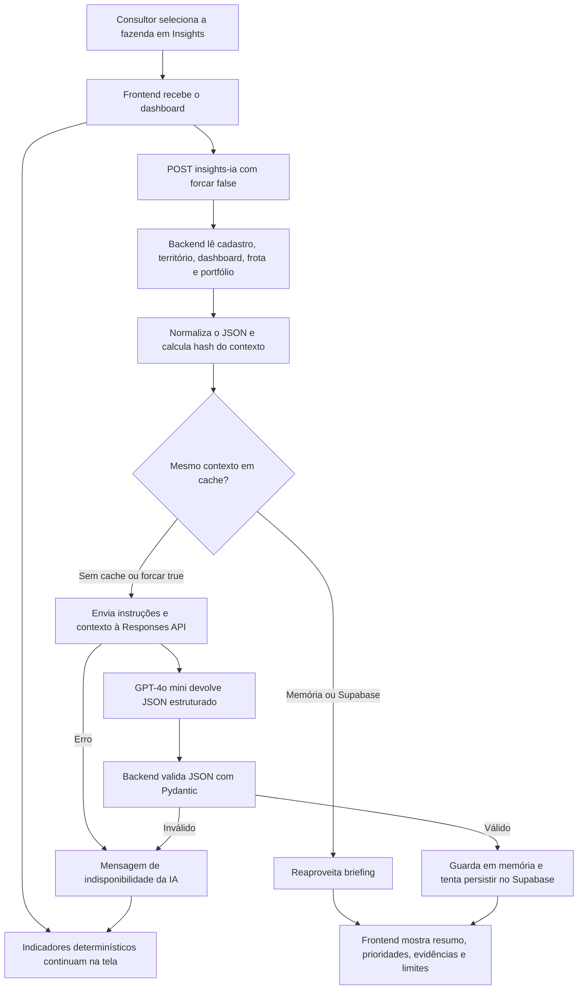

# Insights e LLM: como os dados viram orientação para o consultor

Documento técnico e explicativo da implementação existente em **26/10/2026**. Os nomes de funções, campos e parâmetros abaixo foram conferidos no código do repositório. Exemplos didáticos estão identificados; eles não são análises de uma fazenda real.

## 1. O que a página Insights entrega

A página combina indicadores calculados pelo AgriShield com um briefing textual produzido pelo **GPT-4o mini**. O objetivo é ajudar o consultor a interpretar a situação disponível, organizar perguntas e definir o que precisa ser conferido com o responsável pela propriedade.

Há duas origens de informação na mesma tela:

| Parte da tela | Como é produzida |
| --- | --- |
| Radar para tomada de decisão | Regras JavaScript com prioridades, evidências e ações predefinidas. |
| Briefing prático | LLM recebe um contexto JSON preparado no backend e devolve uma estrutura validada. |
| Previsão de sete dias e condição candidata para validação local | Previsão Open-Meteo e cálculos JavaScript de chuva, temperatura, probabilidade e sequências de dias. |
| Resumo da frota e situação cadastral dos seguros | Agregação Python dos equipamentos cadastrados. |
| Cobertura dos dados | Checklist JavaScript de seis fontes; mede disponibilidade/completude, sem estimar acurácia estatística. |
| Comparação com propriedades da mesma operação | Medianas e proporções calculadas em JavaScript. |
| Distribuição cadastral, condições dos últimos 30 dias e fatores do score | Contagens do cadastro e resultados do processamento determinístico do backend. |

**O score não é calculado pela LLM.** A LLM explica a leitura recebida e sugere um nível de atenção textual. Esse nível não substitui o score numérico e não é uma probabilidade de sinistro.

### Escopo real das integrações

O briefing atual usa o dashboard servido por `get_dashboard()` e o score de `etapa3_engenharia_variaveis.py`. O projeto também possui um motor versionado de exposição do maquinário, integração INMET, análise MapBiomas e módulo hídrico experimental. Esses resultados **não entram automaticamente no contexto da LLM**: `_montar_contexto_insights_ia()` não chama esses serviços nem a rota `/api/v1/exposicao/{id_fazenda}`.

O contexto territorial SRTM/MERIT entra como informação adicional. Isso não significa que o score operacional legado tenha sido recalculado pelo novo motor de exposição ou que os valores dos diferentes motores sejam intercambiáveis.

## 2. Visão completa do fluxo



1. O React aguarda uma fazenda selecionada e um dashboard carregado.
2. O painel envia `POST /api/fazendas/{id_fazenda}/insights-ia` com `{"forcar": false}`. O navegador envia o identificador e a opção de atualização; a composição dos dados acontece no servidor.
3. O backend verifica a existência da fazenda, normaliza o cadastro, consulta o dashboard, lê o registro territorial e agrega o portfólio ativo.
4. Calcula um identificador SHA-256 do contexto, do modelo e da versão do prompt.
5. Se o contexto corresponder a um briefing em cache e a atualização não tiver sido forçada, devolve esse briefing.
6. Caso contrário, faz a chamada à OpenAI, valida a resposta e a guarda em memória. Com Supabase configurado, também tenta persistir o resultado.
7. O React apresenta a análise e indica se é uma “Nova leitura” ou uma “Leitura reaproveitada”, com data/hora de geração quando disponível.

## 3. De onde vêm os dados antes da LLM

### 3.1 Cadastro da propriedade

O backend usa os repositórios do projeto, com persistência no Supabase quando configurado e suporte local de cadastro em CSV. Do registro normalizado, o briefing utiliza:

- Identificador e nome da fazenda.
- Cidade e UF.
- Área em hectares.
- Tipo de operação, como `campo` ou `transporte`.
- Indicação cadastral de proximidade de água.
- Status do processamento do contexto territorial.

A proximidade de água é um atributo cadastral. Ela não equivale, por si só, à distância medida de drenagem, à existência de uma inundação ou a uma comprovação de cobertura securitária.

### 3.2 Histórico climático e leitura calculada

`_gerar_score()` reaproveita um resumo em memória ou persistido no Supabase quando disponível. Se precisar processar, consulta a NASA POWER para o intervalo entre a data da execução e os 40 dias anteriores, organiza as variáveis e aplica regras determinísticas.

As variáveis coletadas são temperatura média, máxima e mínima, precipitação, umidade relativa do ar, radiação solar e vento. O processamento produz, entre outros resultados:

- Acumulados de chuva em três e sete dias.
- Média de umidade atmosférica em três dias.
- Sequência de dias com precipitação inferior a 1 mm.
- Classificação agroclimática diária.
- Indício de encharcamento, definido nessa rotina por chuva de sete dias maior que 50 mm e umidade atmosférica média de três dias maior que 70%.
- Condição operacional diária e distribuição dos últimos 30 registros.
- Score de 0 a 100, condição atual e fatores com suas contribuições em pontos.

No enriquecimento legado, valores numéricos ausentes são preenchidos pela mediana da coluna quando há uma mediana disponível. Portanto, parte de uma série processada pode conter imputação; o JSON do briefing não fornece um indicador de imputação para cada valor. O indício de encharcamento é uma heurística baseada em chuva e umidade do ar, sem constituir medição direta da umidade do solo.

O score soma pontos por chuva acumulada, umidade/indício de encharcamento, proximidade de água, condição agroclimática e ajuste para transporte, com teto de 100. A condição do resumo é `IDEAIS` para score abaixo de 35, `ATENÇÃO` de 35 a 59 e `RESTRIÇÃO` a partir de 60. **Pontuação maior representa maior atenção/restrição nesse cálculo.** A distribuição de 30 dias, por sua vez, vem da condição diária, e não de 30 scores recalculados com os mesmos limiares do resumo.

O objeto `leitura_calculada` enviado à LLM contém o resumo do dashboard, retirando apenas o subobjeto `fazenda`. No contrato atual, isso inclui `score`, `condicao_atual`, `data_referencia`, `distribuicao_30d`, `fatores_risco`, `metricas_dia` e `origem_dados`.

### 3.3 Previsão e alertas

O dashboard consulta a fachada `previsao_open_meteo()` com sete dias e usa os primeiros cinco para os alertas de curto prazo. Cada dia contém:

| Campo | Significado |
| --- | --- |
| `data` | Data civil do dia previsto. |
| `precipitacao_mm` | Precipitação diária prevista em milímetros. |
| `prob_precip_pct` | Probabilidade máxima diária de precipitação, em percentual. |
| `temp_max_c` | Temperatura máxima diária prevista em graus Celsius. |

O backend cria alertas de chuva intensa por regras: pelo menos 30 mm, ou pelo menos 18 mm com probabilidade de chuva a partir de 70%. A severidade é alta a partir de 35 mm e média nos demais casos dessa regra. Também pode adicionar alerta de indício de encharcamento e alerta heurístico de alagamento combinando cadastro, chuva recente e previsão de cinco dias. Ordena os alertas por severidade e entrega no máximo cinco ao dashboard.

A probabilidade de chuva recebida da fonte não é uma probabilidade de sinistro. Os limiares dos alertas do backend e os limiares de triagem diária do frontend têm propósitos diferentes; não são a mesma classificação.

O contexto da LLM leva as listas de cinco e sete dias e os alertas, mas não copia os campos de nível superior `origem_previsao` e `previsao_atualizada_em` do dashboard. O frontend usa esses metadados para apresentar a qualidade da previsão. Quando a previsão real falha, a fachada não entrega os dias sintéticos ao dashboard nem à LLM.

### 3.4 Contexto territorial

O cadastro territorial vem do processamento geoespacial baseado em Google Earth Engine, com SRTM e MERIT. Para o briefing, somente os campos abaixo são selecionados, quando não estão vazios:

| Campo | Papel no contexto |
| --- | --- |
| `status` | Indica se a leitura territorial foi obtida e seu estado. |
| `area_ha_referencia` | Área de referência do processamento. |
| `declividade_media_graus` | Inclinação média calculada em graus. |
| `posicao_topografica_relativa_m` | Posição altimétrica relativa no entorno, em metros. |
| `distancia_drenagem_m` | Distância estimada à drenagem, em metros. |
| `area_drenagem_montante_km2` | Área contribuinte de drenagem a montante, em km². |
| `qualidade` | Cobertura, indicadores e flags de qualidade do processamento. |
| `calculado_em_utc` | Momento do cálculo territorial. |

Um registro territorial ausente ou parcial limita a interpretação. A LLM não recebe raster, imagem de satélite, polígono ou a saída geoespacial completa para recalcular essas medidas. O objeto `qualidade` é repassado integralmente e pode incluir `pixel_drenagem.latitude` e `pixel_drenagem.longitude`, coordenadas do pixel MERIT selecionado na drenagem próxima. Elas não são as coordenadas cadastrais exatas da fazenda, mas continuam sendo informação de localização e precisam ser consideradas ao avaliar a transmissão de dados.

### 3.5 Inventário e seguro cadastral da frota

O backend consulta os equipamentos da fazenda e chama `resumo_maquinarios()`. A data de referência padrão é o dia corrente no fuso de negócio `America/Sao_Paulo`. A LLM recebe **o resumo agregado**, com:

- Disponibilidade do inventário, total, quantidade por tipo e número de tipos distintos.
- Equipamentos com indicação de seguro e sem essa indicação; percentual de seguro cadastrado.
- Seguros vigentes pela data cadastrada, percentual vigente, vencidos e vencendo em 30, 60 e 90 dias; próximo vencimento futuro.
- Idade média e faixas de idade, calculadas a partir do ano de fabricação.
- Soma dos horímetros informados, quantidade de horímetros e média dos equipamentos motorizados.
- Total de motorizados, quantidade de motorizados com horímetro e uso diário agregado/médio declarado.
- Quantidade e percentual de cadastros com chassi preenchido, sem enviar o valor dos chassis.
- Data/hora da última atualização cadastral encontrada.

`segurados` conta a indicação de seguro. `seguros_vigentes` exige também uma data de vencimento igual ou posterior ao dia de referência. Por isso, seguro cadastrado, seguro vigente e validação de cobertura na apólice são conceitos diferentes. As janelas de 30, 60 e 90 dias são inclusivas e cumulativas.

Idade e horímetro são informações cadastrais. Não fornecem, isoladamente, diagnóstico de manutenção, condição mecânica, disponibilidade real ou probabilidade de falha. A soma de horas/dia declaradas de vários equipamentos também não é a jornada de uma única máquina.

Se ocorrer erro tratado na obtenção do inventário, o dashboard informa `{"disponivel": false}` e os demais indicadores continuam sendo preparados.

### 3.6 Portfólio

O backend considera os cadastros **não arquivados** para preparar um resumo geral:

- Total de fazendas ativas.
- Quantidade com operação em campo e quantidade restante como transporte.
- Número de cadastros com proximidade de água sinalizada.
- Lista ordenada de UFs presentes.

Esse contexto não contém a lista detalhada das demais fazendas. As medianas exibidas no comparativo do frontend são outro cálculo e não são adicionadas como campos próprios no contexto da LLM.

## 4. Estrutura exata do contexto

O envelope de dados montado pelo backend segue esta organização:

```text
contexto
├── fazenda
│   ├── id, nome, cidade, uf, area_ha, tipo_operacao
│   ├── proximidade_agua_cadastral
│   └── status_contexto_territorial
├── leitura_calculada
│   └── resumo do score, sem o subobjeto fazenda
├── alertas
├── previsao_5_dias
├── previsao_7_dias
├── contexto_territorial
│   └── seleção de oito campos territoriais
├── frota_maquinarios
│   └── resumo agregado, ou disponivel false
└── portfolio
    ├── total_fazendas_ativas
    ├── operacao_campo, operacao_transporte
    ├── cadastros_proximos_agua
    └── ufs
```

Antes de serializar, `contexto_canonico()` normaliza dicionários, listas e tuplas. Números `NaN` ou infinitos viram `null`; objetos com `isoformat()` viram datas/horas em texto e outros tipos não JSON viram texto. Isso evita enviar JSON numérico inválido. A rotina **não é um anonimizador**: os campos selecionados de identificação continuam no contexto.

O contrato de `leitura_calculada` é repassado com exclusão de um único campo, em vez de uma lista fechada de todos os campos permitidos. Ao acrescentar dados ao resumo do score no futuro, deve-se revisar o que passa a ser transmitido.

## 5. Como a LLM transforma o contexto em briefing

O backend faz uma chamada única de geração por tentativa. A requisição não fornece ferramentas de navegação, SQL, busca de documentos ou execução de ações. Não há pipeline de embeddings, banco vetorial, RAG ou treinamento específico da LLM implementado nesse fluxo. O conhecimento atualizado da fazenda chega na forma do JSON anexado ao prompt.

O modelo recebe duas peças:

1. **Instruções fixas:** definem o papel de analista de risco rural e as regras de interpretação.
2. **Mensagem de usuário:** começa com `Prepare o briefing a partir deste contexto:` e inclui o JSON completo do contexto, serializado com chaves ordenadas.

Ele deve ler os fatos disponíveis, cruzar os domínios quando existir suporte nos dados, escolher assuntos úteis para o consultor, explicar o motivo e formular uma ação de conferência/orientação. Para cada prioridade, deve escrever `dado_base`, tornando visível a evidência que motivou a recomendação.

### Instruções fixas atualmente usadas

O texto a seguir reproduz o conteúdo de `INSTRUCOES` no serviço; os acentos ausentes fazem parte da string original do código:

```text
Voce e um analista de risco rural que prepara briefings para consultores de
seguros. Responda em portugues do Brasil, com linguagem clara, objetiva e
pratica. Use exclusivamente os dados fornecidos. Nao invente clima, perdas,
probabilidades, valores financeiros, coberturas ou diagnosticos. Nao altere o
score calculado pela aplicacao. Diferencie fatos observados de limitacoes dos
dados. Priorize medidas que o consultor pode verificar, comunicar ou orientar,
sem prometer reducao de risco. Cada recomendacao deve citar em `dado_base` o
dado concreto que a sustenta. Quando houver relacao sustentada pelos dados,
cruze clima, leitura calculada, territorio, frota e situacao cadastral do
seguro; nao force conexoes. Entregue ate 5 prioridades, somente quando houver
evidencia suficiente; a lista pode ter menos itens ou ficar vazia. Entregue ate
3 perguntas para o consultor, ate 4 pontos positivos e ao menos uma limitacao.
Esta analise apoia, mas nao substitui avaliacao tecnica, vistoria ou regras da
apolice. Seguro cadastrado nao significa necessariamente seguro vigente. Dados
de maquinario sao cadastrais e descritivos. Nao infira falha, necessidade de
manutencao, disponibilidade ou probabilidade de sinistro apenas por idade ou
horimetro. A previsao diaria sem vento e condicao do solo pode indicar somente
um periodo candidato a validacao local, nunca uma janela operacional garantida.
```

Essas instruções orientam a geração. Não constituem prova automática de que todo texto gerado é correto: a validação implementada verifica a estrutura da resposta, sem demonstrar causalidade ou conferir semanticamente cada número citado.

### Exemplo didático de leitura

**Cenário inventado apenas para explicar o mecanismo:** o backend já calculou score 68/100 e condição `RESTRIÇÃO`; existem 62 mm de chuva acumulada em sete dias, previsão de 32 mm amanhã com 80% de probabilidade de chuva, proximidade de água sinalizada e um seguro cadastrado vencido na frota.

| Fato recebido | Interpretação possível no briefing | Próximo passo possível |
| --- | --- | --- |
| Chuva recente, previsão e proximidade de água | Há elementos para priorizar a conferência de acesso e planejamento. | Confirmar condição local das rotas e do solo com o responsável. |
| Um seguro cadastrado vencido | Existe pendência cadastral que exige validação documental. | Conferir renovação, vigência e vínculo na apólice. |
| Score 68/100 já calculado | A leitura publicada pede atenção aos fatores informados. | Usar os fatores como roteiro de conversa, mantendo o valor do score. |

Uma prioridade poderia citar em `dado_base`: “62 mm acumulados em sete dias; previsão de 32 mm amanhã; proximidade de água cadastrada”. A conclusão seria uma orientação para **validar**, sem afirmar que haverá alagamento, dano ou indenização. O exemplo não garante a redação nem a ordem das prioridades: a saída textual pode variar entre gerações.

## 6. Integração técnica com a OpenAI

| Configuração do código | Valor |
| --- | --- |
| Modelo | `gpt-4o-mini`, definido em constante no serviço. |
| Endpoint | `POST https://api.openai.com/v1/responses`. |
| Cliente HTTP | Biblioteca Python `requests`; o fluxo não depende do SDK OpenAI. |
| Autorização | Header `Authorization: Bearer ...`, formado somente no backend. |
| Variável de ambiente | `OPENAI_API_KEY`. |
| Versão do prompt | `2026-09-28.2`. |
| Armazenamento de resposta na API | `store: false`. |
| Temperatura | `0.2`. |
| Limite da saída | `max_output_tokens: 1800`. |
| Formato solicitado | `text.format.type: json_schema`, nome `agrishield_insights`, `strict: true`. |
| Schema | Gerado por `InsightGerado.model_json_schema()`. |
| Timeout padrão | 5 segundos para conexão e 55 para leitura, por tentativa HTTP; não é prazo total da página. |
| Tentativas | Até duas, somente repetindo automaticamente falhas temporárias. |

Temperatura baixa reduz a liberdade de geração, mas não torna o texto determinístico. O teto de tokens vale para a saída; o código não implementa orçamento explícito de tokens de entrada, estimativa monetária ou limite de custo por usuário nesse endpoint.

O fluxo é de uma análise por contexto, sem histórico de conversa, `previous_response_id`, ferramentas ou streaming. O objeto `usage` devolvido pela API é guardado para persistência quando presente; ele não é incluído no envelope que o painel recebe.

## 7. Formato, validação e apresentação da resposta

O schema exige os seguintes campos:

| Campo | Contrato |
| --- | --- |
| `resumo_executivo` | Texto de síntese. |
| `nivel_atencao` | `baixo`, `moderado`, `alto` ou `critico`. |
| `leitura_principal` | Texto explicativo da leitura. |
| `prioridades` | De zero a cinco itens. |
| `perguntas_consultor` | Até três textos. |
| `pontos_positivos` | Até quatro textos. |
| `limitacoes` | De um a cinco textos. |

Cada prioridade tem `titulo`, `prioridade`, `motivo`, `acao_recomendada` e `dado_base`. A prioridade aceita `imediata`, `hoje`, `proximos_dias` ou `monitorar`. Os modelos Pydantic proíbem campos extras tanto no briefing quanto em cada prioridade.

O serviço extrai o texto de `output_text` ou do conteúdo da saída, faz `json.loads()` e executa `InsightGerado.model_validate()`. JSON malformado ou estrutura fora do contrato gera erro de serviço; a resposta inválida não segue pelo caminho de persistência de uma geração bem-sucedida. Uma lista de prioridades vazia é válida e tem estado próprio na interface.

O schema controla campos, tipos, valores enumerados e limites das listas. Ele não obriga texto não vazio em cada string, não comprova que `dado_base` foi copiado fielmente do contexto e não valida a adequação técnica de cada recomendação. O consultor precisa conferir evidências e limitações.

A resposta HTTP de sucesso para o frontend contém:

```json
{
  "id_fazenda": "7",
  "modelo": "gpt-4o-mini",
  "gerado_em": "2026-10-26T15:00:00+00:00",
  "origem": "openai",
  "cache": false,
  "insight": {
    "resumo_executivo": "Exemplo didático de estrutura.",
    "nivel_atencao": "moderado",
    "leitura_principal": "Conferir os dados que sustentam a leitura.",
    "prioridades": [],
    "perguntas_consultor": [],
    "pontos_positivos": [],
    "limitacoes": ["Exemplo inventado; não representa análise de uma fazenda."]
  }
}
```

`origem` pode ser `openai`, `cache_memoria` ou `cache_supabase`; `cache` é verdadeiro nas duas últimas. A data de geração é criada no backend em UTC. O frontend a formata em português brasileiro usando o fuso do navegador.

## 8. O que os cálculos do frontend fazem

### Triagem de cada dia da previsão

`avaliarDiaPrevisao()` aplica as condições em ordem:

| Condição | Resultado |
| --- | --- |
| Chuva, probabilidade e temperatura ausentes | `indisponivel`: dados incompletos. |
| Chuva ≥ 20 mm ou probabilidade ≥ 70% | `restricao`: chuva relevante. |
| Chuva ≥ 5 mm, probabilidade ≥ 40%, máxima ≥ 35 °C ou alguma variável ausente | `atencao`: atenção climática. |
| Demais dias com as três variáveis presentes | `menor_sinal_chuva`. |

`resumirJanelaOperacional()` conta as categorias e procura a maior sequência de dias com menor sinal de chuva. Trata-se de um período candidato à validação local. Vento, condição efetiva do solo, acesso e requisitos da atividade precisam ser conferidos antes de agendar a operação.

A soma de chuva de sete dias só é apresentada como acumulado completo quando existem sete valores válidos. Valores ausentes não viram zero. O card exibe dias da fonte real Open-Meteo; previsão sintética não é apresentada como meteorologia disponível para decisão.

### Cobertura dos dados

`calcularQualidadeDados()` verifica seis itens com o mesmo peso: cadastro, território, score, previsão, inventário e coerência cadastral de seguro. O percentual é a quantidade de itens `ok` dividida por seis, arredondada. Os níveis são `alta` a partir de 85%, `intermediaria` a partir de 60% e `parcial` abaixo disso.

Para a previsão, exige origem `api_open_meteo`, sete dias e três variáveis válidas por dia. Para seguro, verifica existência de frota e se segurados mais sem seguro coincide com o total. Isso mede a presença/coerência básica das fontes; não significa que as apólices estejam vigentes, que todos os dados estejam atualizados ou que o modelo tenha aquele percentual de precisão.

### Radar operacional

`construirRadarOperacional()` cria até três itens, ordenados por `imediata`, `hoje`, `proximos_dias` e `monitorar`. Entre as regras estão:

- Seguro cadastrado vencido gera prioridade imediata de conferência; equipamentos sem seguro cadastrado ou vencimentos próximos também geram revisão.
- Alerta climático ou dias com chuva relevante geram validação do planejamento; alerta de severidade alta recebe prioridade “hoje”.
- Condição do score em atenção/restrição gera revisão dos fatores publicados.
- Frota vazia e cobertura dos dados inferior a 85% geram orientação para completar cadastros/fontes.
- Na ausência de sinais prioritários, orienta manter o acompanhamento.

O radar existe independentemente da OpenAI. Seus itens não são uma cópia das prioridades da LLM e não são incluídos como objeto separado no prompt.

### Comparação de portfólio

`calcularComparativoPortfolio()` seleciona propriedades do mesmo tipo de operação e calcula mediana de área, mediana de quantidade de equipamentos e proporção com contexto territorial concluído. Exige pelo menos duas propriedades para considerar a base suficiente e exclui contagens de frota explicitamente indisponíveis da mediana. É contexto cadastral, sem ranking atuarial ou estimativa de perdas.

## 9. Cache, atualização e concorrência

### Identidade da análise

O hash SHA-256 tem 64 caracteres hexadecimais e usa este envelope:

```text
{
  versao_prompt: VERSAO_PROMPT_INSIGHTS,
  modelo: MODELO_OPENAI_INSIGHTS,
  contexto: contexto_canonico(contexto)
}
```

A serialização ordena as chaves, usa separadores compactos e recusa números JSON inválidos. Contextos iguais produzem o mesmo hash; alteração do contexto, do modelo ou da versão do prompt muda a identidade da análise. A ordem de listas também participa do hash. Alterar o texto das instruções sem atualizar a versão do prompt não muda o hash por si só.

### Ordem de consulta e persistência

1. O backend monta o contexto **antes** de consultar o cache; um cache hit ainda pode envolver leituras do banco e consulta da previsão.
2. Verifica `_cache_insights_ia`, um dicionário do processo Python indexado por fazenda, exigindo o mesmo hash.
3. Com Supabase configurado, busca `agrishield_insights_ia` por fazenda e hash.
4. Se encontrar, copia para memória e devolve a leitura reaproveitada.
5. Se precisar gerar, grava em memória e faz `upsert` na tabela com conflito em `id_fazenda`.

A tabela mantém **um briefing por fazenda**, com hash, modelo, JSON do insight, uso de tokens e datas. Uma nova geração substitui o registro anterior da fazenda; ela não cria um histórico completo de briefings. O contexto/prompt integral não é gravado nessa tabela. O schema versionado habilita RLS e revoga acesso direto aos papéis `anon` e `authenticated`, mantendo esse cache no caminho do backend.

### Quando atualizar

- “Atualizar análise” envia `{"forcar": true}` e ignora os dois caches de briefing.
- Cadastro manual ou importação de equipamentos limpa o briefing em memória daquela fazenda.
- Mudanças dos dados que compõem o contexto levam a um hash diferente na próxima chamada. Isso inclui alterações dos agregados, datas relevantes e versão do prompt.
- `POST /api/cache/limpar` limpa os caches de score e briefing **em memória**. Não apaga registros persistidos no Supabase.

**Não existe TTL de expiração por tempo no cache de insights.** O reaproveitamento depende da igualdade de contexto, sem uma idade máxima fixa. A atualização forçada do briefing não força o reprocessamento NASA POWER: `_gerar_score()` tem cache próprio e pode continuar usando seu resumo persistido. Para dados climáticos históricos renovados, é necessário o fluxo de processamento climático correspondente.

Não há lock por fazenda ou mecanismo de deduplicação de chamadas simultâneas implementado nesse endpoint. Duas requisições concorrentes podem gerar duas chamadas à OpenAI; no Supabase prevalece o último `upsert`. A memória é local de cada processo/instância e se perde em reinicializações; o cache persistente permite reaproveitamento entre execuções.

No navegador, `requisicaoAtual` impede que uma resposta antiga sobrescreva a seleção mais recente. Isso descarta a atualização visual obsoleta, mas não cancela a chamada HTTP nem a geração já iniciada no backend.

## 10. Privacidade, credenciais e dados transmitidos

A chave `OPENAI_API_KEY` é lida no backend. Ela é enviada no header de autorização para a OpenAI, sem entrar no JSON do contexto nem na resposta do painel. Não deve ser configurada com prefixo `VITE_`, incluída no código do React ou versionada no repositório.

Na composição atual do contexto:

| São transmitidos à OpenAI | Não são selecionados para o contexto |
| --- | --- |
| ID e nome da fazenda, cidade/UF, área e tipo de operação. | Número da apólice da fazenda, CEP, endereço completo e coordenadas exatas. |
| Score, fatores, métricas, alertas, previsão diária e origem do histórico no resumo. | Série bruta inteira NASA POWER e DataFrame completo de processamento. |
| Campos territoriais selecionados e seus indicadores de qualidade, incluindo coordenadas do pixel de drenagem quando presentes. | Raster/imagens de satélite e resultado territorial completo. |
| Resumo agregado da frota, datas de seguro e quantidades de chassis informados. | Chassis, números de apólice e cadastros individuais dos equipamentos. |
| Totais e UFs do portfólio ativo. | Lista detalhada das demais propriedades e dados de perfil/login dos consultores. |

O uso do serviço transmite informações operacionais identificáveis: não é processamento exclusivamente local nem anonimização integral. A exclusão das coordenadas exatas do cadastro não remove as coordenadas derivadas de `qualidade.pixel_drenagem`. O módulo de geração não registra prompts, respostas ou credenciais em logs; o briefing gerado é armazenado pelo próprio aplicativo para cache.

`store: false` solicita que a resposta não seja mantida como estado recuperável padrão da Responses API. Isso **não demonstra retenção zero de todos os dados pelo provedor**, pois controles de monitoramento e retenção dependem das condições/configurações da conta. A distinção está descrita na [documentação oficial de controles de dados da OpenAI](https://developers.openai.com/api/docs/guides/your-data), consultada em 26/10/2026.

A proteção de acesso ao endpoint acompanha o middleware geral: em Vercel, a autenticação é exigida por padrão; `AGRISHIELD_AUTH_REQUIRED` permite configurar esse comportamento. Quando exigida, o middleware valida o usuário e requer perfil aprovado para as rotas funcionais. Essa documentação descreve o código e o schema versionados; não comprova quais configurações estão aplicadas em um ambiente remoto específico.

## 11. Falhas e comportamento sem IA

| Situação | Tratamento existente |
| --- | --- |
| Fazenda não encontrada | HTTP 404 antes de gerar o briefing. |
| Coordenadas ausentes ao precisar obter o score | HTTP 422 no fluxo climático; o contexto não chega à geração. |
| `OPENAI_API_KEY` ausente, sem cache reaproveitável | HTTP 503 com orientação de configuração do backend. |
| OpenAI rejeita a chave | Mensagem específica, sem expor a credencial. |
| Limite de uso OpenAI, rede ou erro 5xx | Uma nova tentativa após 0,6 segundo; persistindo a falha, mensagem segura e HTTP 502. |
| Outros erros HTTP da OpenAI | HTTP 502, sem repetição automática para erros não temporários. |
| JSON ou schema da geração inválido | Erro de validação apresentado como HTTP 502, sem cachear como nova análise válida. |
| Falha tratada ao ler o cache de insights no Supabase | Registra aviso sem conteúdo do prompt e tenta gerar normalmente. |
| Falha tratada ao salvar o briefing no Supabase | Devolve o briefing já gerado e mantém a cópia em memória. |
| Inventário temporariamente indisponível | Envia indisponibilidade da frota no contexto e preserva os demais dados. |
| Open-Meteo indisponível | Previsão real fica vazia; o card informa indisponibilidade e não usa previsão sintética para orientar a decisão. |

As falhas de banco tratadas acima dizem respeito ao cache de insights e ao resumo de frota. Outros erros durante a preparação do contexto podem impedir a requisição antes da OpenAI; não há garantia de funcionamento sem nenhuma dependência disponível.

O frontend apresenta uma mensagem no painel de IA e mantém os indicadores determinísticos já recebidos. Não cria um texto fictício para parecer resposta do modelo. Se uma atualização falhar depois de um briefing ter sido mostrado, o componente pode manter o resultado anterior acompanhado do aviso de erro. Sem resultado anterior, oferece “Tentar novamente”.

### Dados de demonstração

Não existe um modo separado de LLM simulada nesse painel. Sem chave e sem cache válido, o briefing fica indisponível.

O coletor legado NASA POWER possui fallback para uma série sintética determinística, marcada com `origem_dados: "simulado"`; nesse caso, o resumo calculado e enviado ao briefing é demonstrativo. A geração por IA não torna essa série observada. Confira a origem e a data de referência antes de interpretar o texto.

O cliente rico Open-Meteo também possui saída sintética para seu contrato interno, mas a fachada usada pelo dashboard descarta esses dias: devolve previsão/alertas meteorológicos vazios e origem `fallback_simulado`. Assim, a LLM não recebe aquela previsão sintética como uma lista de dias válidos.

## 12. Limites que devem acompanhar a interpretação

- O briefing apoia a conversa do consultor e não substitui vistoria, agronomia, avaliação técnica, condições contratuais ou decisão de subscrição.
- Não estima prêmio, indenização, valor de perda ou probabilidade de sinistro.
- As regras do score e dos alertas são as implementadas no protótipo; uma explicação fluente não representa validação atuarial dessas regras.
- A qualidade da análise depende da origem, completude, data e correção dos dados recebidos. O cache do briefing não corrige um score histórico desatualizado.
- A validação estrutural reduz erros de formato, mas não elimina interpretações incorretas, recomendações fracas ou números mal citados.
- A evidência mostrada em `dado_base` é texto produzido pela LLM, sem mecanismo separado de citação verificável por campo.
- O nível de atenção sugerido pela LLM pode variar entre gerações. Deve ser interpretado em conjunto com os dados calculados e as limitações declaradas.
- Não há ação automática sobre apólices, manutenção ou operação da fazenda. A saída é informativa e exige decisão humana.

## 13. Onde conferir e manter essa documentação

| Assunto | Arquivo de referência |
| --- | --- |
| Montagem do contexto, rota, cache em memória e envelope HTTP | [`backend/app/main.py`](../backend/app/main.py), funções `_montar_contexto_insights_ia`, `post_insights_ia` e `_resposta_insights_ia`. |
| Prompt, modelo, parâmetros, hash, retry e schema | [`backend/app/servico_insights_ia.py`](../backend/app/servico_insights_ia.py). |
| Cache persistente por fazenda | [`backend/persistencia/insights_ia.py`](../backend/persistencia/insights_ia.py). |
| Tabela e permissões versionadas | [`supabase/schema.sql`](../supabase/schema.sql), tabela `agrishield_insights_ia`. |
| Enriquecimento e score que entram no briefing | [`backend/etl/etapa3_engenharia_variaveis.py`](../backend/etl/etapa3_engenharia_variaveis.py). |
| NASA POWER e origem simulada | [`backend/etl/etapa2_coleta_nasa_power.py`](../backend/etl/etapa2_coleta_nasa_power.py). |
| Fachada Open-Meteo e alertas de chuva | [`backend/app/servicos_externos.py`](../backend/app/servicos_externos.py). |
| Resumo e interpretação cadastral da frota | [`backend/app/maquinarios.py`](../backend/app/maquinarios.py). |
| Apresentação e concorrência visual | [`frontend/src/pages/InsightsPage.jsx`](../frontend/src/pages/InsightsPage.jsx). |
| Radar, qualidade, sequência de dias e comparativo | [`frontend/src/pages/insightsCalculations.js`](../frontend/src/pages/insightsCalculations.js). |

Os testes existentes cobrem geração/configuração segura, formato da requisição, retry, estabilidade do hash, reaproveitamento/atualização forçada, persistência por fazenda, apresentação, continuidade dos indicadores sem IA e cálculos determinísticos. São verificações com mocks e dados de teste; não constituem avaliação agronômica, atuarial ou factual de respostas reais do modelo.

Arquivos de teste principais: `test_servico_insights_ia.py`, `test_api_insights_ia.py`, `test_persistencia_insights_ia.py`, `InsightsPage.test.jsx` e `insightsCalculations.test.js`.

Ao mudar o contexto, o modelo, as instruções ou os limiares, atualize este documento. Ao mudar as instruções fixas, atualize também `VERSAO_PROMPT_INSIGHTS` para impedir reaproveitamento de um briefing produzido sob instruções anteriores.
